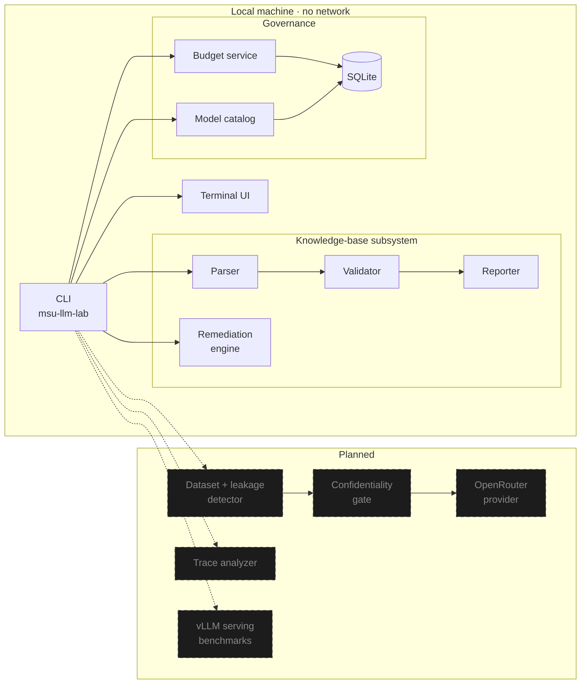

<div align="center">

# MSU LLM Inference Workbench

### Audit the knowledge base. Evaluate the models. Cap the spend. Understand the serving stack.

**A local-first, zero-network engineering workbench for evaluating LLMs behind a university admissions counsellor.**

<br />

[](https://www.python.org/)
[](#roadmap)
[](#safety-model)
[](#budget-ledger)
[](#development)

[**Preview**](#preview) ·
[**Quick Start**](#quick-start) ·
[**Features**](#features) ·
[**Architecture**](#architecture) ·
[**Safety Model**](#safety-model) ·
[**Roadmap**](#roadmap) ·
[**Docs**](#documentation)

</div>

---

## Why this exists

Management and Science University (MSU), Malaysia runs an AI counsellor that answers questions about programmes, entry requirements, fees and procedures. It is only as good as two things: **the knowledge base behind it** and **the model serving it**.

Most teams swap models and tune prompts while ignoring the first problem. A question tagged "Accounting" sitting in a Broadcasting section, or a PhD fee quoted as both RM62,500 and RM63,500 in one answer, will make *any* model hallucinate.

This workbench attacks both problems, in order:

| Step | Question it answers | Status |
|:--:|---|:--:|
| **1** | Is the knowledge base actually correct? | Shipped |
| **2** | Can we build a leak-free evaluation dataset from it? | Next |
| **3** | Which model gives the best accuracy, groundedness, latency and cost? | Planned |
| **4** | Why do production answers fail — routing, retrieval, generation or KB? | Planned |
| **5** | Can we serve a small open-weight model ourselves with vLLM? | Planned |

Everything runs on your laptop, against local files and SQLite, with **no outbound network calls and no API keys**.

---

## Features

<table>
<tr>
<td width="50%" valign="top">

### Knowledge-Base Audit
Parses messy, escaped markdown (`\*\*Question:\*\*`) into structured records and flags:
- missing / empty questions and answers
- exact and normalized duplicate questions
- conflicting RM fee figures in one answer
- question ↔ section programme mismatches
- time-sensitive intake dates and years
- stray tokens and malformed headings

Outputs a terminal summary plus CSV and Markdown reports.

</td>
<td width="50%" valign="top">

### Provable Immutability
Source files are **never** modified. Every audit and remediation computes a SHA-256 hash before and after. Any byte-level difference aborts the run with exit code `2`.

Remediation writes a **separate versioned copy**, and anything ambiguous is escalated to a human instead of guessed.

</td>
</tr>
<tr>
<td width="50%" valign="top">

### Budget Ledger
A SQLite-backed ledger with exact `Decimal` arithmetic and integer micro-dollars, enforcing:

| Limit | Default |
|---|--:|
| Total experiment ceiling | `$10.00` |
| Pilot ceiling | `$2.00` |
| Per-run cap | `$0.50` |
| Per-case cap | `$0.02` |

</td>
<td width="50%" valign="top">

### Terminal Dashboard
A charcoal-monochrome, full-screen TUI in the spirit of `btop` and `lazygit`: system health, candidate-model inspector, audit findings, and spend status in one place.

```bash
uv run msu-llm-lab ui
```

</td>
</tr>
</table>

### Remediation, with a conscience

Findings are classified, not just fixed:

| Classification | Example | Action |
|---|---|---|
| `CONFIRMED_CONTENT_DEFECT` | "Bachelor in Accounting" question under the Broadcasting section | **Auto-fixed** into a clean copy |
| `CONTRADICTORY_FACT` | PhD fee quoted as RM62,500 *and* RM63,500 | **Blocked**, needs official verification |
| `POLICY_INTAKE_DATE` | Intake months and years from 2022–2025 | **Flagged**, needs admissions calendar |
| `CURRICULUM_MPU_RULE` | MUET Band 3 vs Band 4 across faculties | **Escalated** to KB owner |
| `DUPLICATE_ENTRY` | Same question repeated across programmes | **Investigated** before merging |

> The system will never silently pick a number. If two facts disagree, a human decides.

---

## Preview

<div align="center">

</div>

---

## Quick Start

**Requirements:** Python 3.11+ and [`uv`](https://github.com/astral-sh/uv) (or plain `pip`).

```bash
git clone https://github.com/Sudharsanselvaraj/Model-Systems-Workbench.git
cd Model-Systems-Workbench

uv sync                      # or: pip install -e ".[dev]"
```

### Try it in 30 seconds

```bash
uv run msu-llm-lab ui                  # full-screen dashboard
uv run msu-llm-lab budget status       # spend vs. policy ceilings
uv run msu-llm-lab models list         # candidate model portfolio
```

### Audit a knowledge base

```bash
# Safe dry-run: summary only, nothing written
uv run msu-llm-lab audit-kb "path/to/kb.md" --dry-run

# Full run: CSV + Markdown reports
uv run msu-llm-lab audit-kb "path/to/kb.md" --output-dir reports
```

### Remediate (original file stays untouched)

```bash
# Preview the plan
uv run msu-llm-lab remediate-kb "path/to/kb.md"

# Write a versioned clean copy
uv run msu-llm-lab remediate-kb "path/to/kb.md" \
  --apply --output data/remediated/MSU_Programmes_KB_v1.1_clean.md
```

### Keybindings

| Key | Action |
|---|---|
| `Tab` / `Shift+Tab` | Cycle tabs: Dashboard · Models · Audit · Traces |
| `↑` `↓` / `j` `k` | Navigate lists |
| `b` | Spend ledger |
| `r` | Refresh |
| `q` | Quit |

---

## Architecture



### Repository layout

```text
src/msu_llm_lab/
├── cli.py              # Typer entry point: ui, audit-kb, remediate-kb, budget, models
├── audit/              # parser · validator · reporter · issue models
├── remediation/        # engine · registry of curated findings · models
├── core/               # config & BudgetPolicy · BudgetService
├── storage/            # SQLite manager (ledger + model portfolio)
├── models/             # candidate model catalog
└── tui/                # app loop · screens · health · telemetry · theme · input
tests/                  # audit · budget · remediation · TUI
docs/                   # ARCHITECTURE · IMPLEMENTATION_PLAN · PROJECT_MAP
```

---

## Safety model

Five invariants are non-negotiable:

1. **Immutable sources.** Pre/post SHA-256 verification on every command; mismatch → exit `2`.
2. **No guessing.** Contradictory facts are escalated, never auto-resolved.
3. **Fail-closed confidentiality** *(Phase 2)*. Only `PUBLIC` or `SYNTHETIC` records may ever leave the machine. `INTERNAL`, `CONFIDENTIAL` and `UNCLASSIFIED` are blocked before dispatch.
4. **No secrets in git.** `.env`, keys, `data/`, `reports/`, `*.db` and the university's KB files are all git-ignored.
5. **Local spend ceilings.** Policy limits halt work on your machine before a provider account is touched.

> [!NOTE]
> Budget ceilings are **local governance limits**, not provider-enforced balances. Set hard limits in your provider dashboard too.

---

## Candidate model portfolio

All entries are `UNVERIFIED_CATALOG_ENTRY`: planning baselines with preliminary pricing, **not yet called against any live API**.

| Model | Role | Deployment | $/1M in / out |
|---|---|---|--:|
| `google/gemini-3.5-flash-lite` | High-throughput triage baseline | Hosted direct | 0.075 / 0.30 |
| `anthropic/claude-haiku-5.5` | Fast hosted reasoning candidate | OpenRouter | 0.80 / 4.00 |
| `openai/gpt-6-luna` | Quality-ceiling reference | OpenRouter | 0.15 / 0.60 |
| `qwen/qwen3-8b` | Primary open-weight candidate | OpenRouter → vLLM | 0.20 / 0.20 |
| `qwen/qwen3-14b` | Capacity / reasoning comparison | OpenRouter → vLLM | 0.35 / 0.40 |

---

## Roadmap

- [x] **Phase 0:** discovery and architecture
- [x] **Phase 1:** KB audit, remediation, budget ledger, model catalog, TUI
- [ ] **Phase 2:** evaluation schemas, confidentiality gate, train/dev/test split, n-gram leakage detector
- [ ] **Phase 3:** OpenRouter provider with retry/backoff, secret scrubbing, dry-run mode, model comparison
- [ ] **Phase 4:** redacted Langfuse trace ingestion and failure classification (routing / retrieval / generation / KB)
- [ ] **Phase 5:** LoRA / QLoRA fine-tuning feasibility and GPU sizing
- [ ] **Phase 6:** vLLM benchmarks: TTFT, throughput, KV-cache pressure at 1 / 5 / 10 / 25 concurrent users
- [ ] **Phase 7:** research dashboard with latency-vs-quality frontiers

Full detail: [`docs/IMPLEMENTATION_PLAN.md`](docs/IMPLEMENTATION_PLAN.md).

---

## Development

```bash
uv run pytest            # run everything
uv run pytest -v         # verbose
uv run pytest tests/test_audit.py
```

> [!IMPORTANT]
> The university knowledge-base files are confidential and git-ignored. Tests that hash or remediate those exact files (`test_remediation_engine_dry_run_preserves_source_hash`, `test_remediation_cli_command`, `test_health_checks_live`) need them in the repo root and will fail without them. Everything else runs offline against an in-memory database.

### Contributing

Issues and PRs are welcome, especially for the Phase 2 leakage detector and the validator heuristics. Please:

1. Open an issue before large changes.
2. Add tests for new validators or remediation rules.
3. Never commit data from the real knowledge base.

---

## Documentation

| Doc | What's inside |
|---|---|
| [`ARCHITECTURE.md`](docs/ARCHITECTURE.md) | Design, data flow, security boundaries |
| [`IMPLEMENTATION_PLAN.md`](docs/IMPLEMENTATION_PLAN.md) | Phases, acceptance criteria, milestones |
| [`PROJECT_MAP.md`](docs/PROJECT_MAP.md) | Workspace inventory, data quirks, counting method |

---

## License & context

An internal research tool for evaluating and optimizing the MSU admissions language-model system. Source knowledge-base documents remain the property of MSU. Open-source licensing for the tooling is under review.
