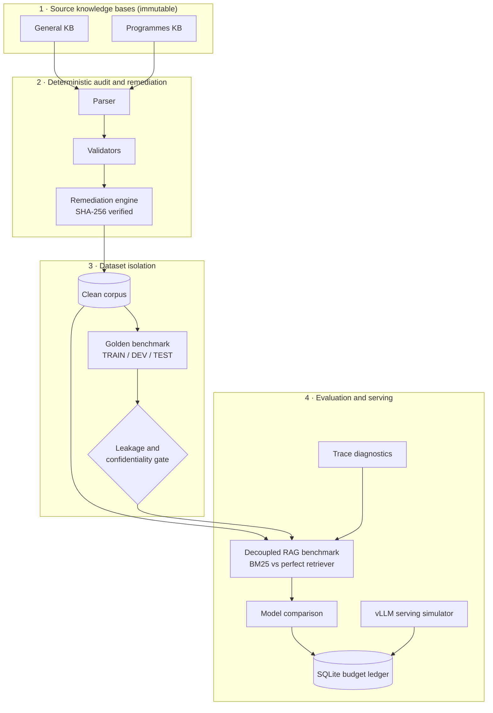

<div align="center">


# MSU LLM Workbench

**Fix the knowledge base before you blame the model.**

A local-first research lab for auditing RAG knowledge bases, benchmarking retrieval and generation separately, diagnosing production traces, and sizing self-hosted vLLM serving, all under a hard spend ceiling.

<p>
  <a href="https://github.com/Sudharsanselvaraj/Model-Systems-Workbench/stargazers"></a>
  
  
  
  
  
</p>

<p>
  <a href="#quickstart"><b>Quickstart</b></a> ·
  <a href="#why-this-exists"><b>Why</b></a> ·
  <a href="#how-it-works"><b>Architecture</b></a> ·
  <a href="#commands"><b>Commands</b></a> ·
  <a href="#python-api"><b>Python API</b></a> ·
  <a href="#safety-model"><b>Safety</b></a> ·
  <a href="#roadmap"><b>Roadmap</b></a> ·
  <a href="docs/ARCHITECTURE.md"><b>Docs</b></a>
</p>

</div>

> [!NOTE]
> **Alpha.** Phases 0–6 are complete and tested. Live provider evaluation (Phase 7) is in progress. Model IDs and prices in the catalog are **unverified planning baselines**, not live-validated figures.

<p align="center">
  
</p>

---

## Why this exists

An admissions chatbot gives a wrong answer. The usual reaction is to swap the model. Often the model was never the problem:

- A *Bachelor in Accounting* question filed under the *Broadcasting* section.
- A PhD fee quoted as both **RM62,500** and **RM63,500** in one answer.
- A question with no answer tag at all, so retrieval has nothing to ground on.

No model fixes that. This workbench was built around the opposite order of operations:

| # | Step | What you get |
|:-:|---|---|
| 1 | **Audit the KB first** | Structural defects, duplicates and conflicting figures, found deterministically |
| 2 | **Build leak-free eval sets** | Train/dev/test isolation, n-gram leakage detection, confidentiality classes |
| 3 | **Benchmark retrieval and generation separately** | Recall@k, Precision@k, MRR, groundedness, with each failure attributed to a layer |
| 4 | **Compare candidate models** | Quality, latency and cost under a local spend ledger |
| 5 | **Size self-hosted serving** | KV-cache pressure, concurrency ramp, and cloud-vs-owned-hardware cost crossover |

---

## Quickstart

**You need:** Python 3.11+, [`uv`](https://github.com/astral-sh/uv) (or `pip`), and a Unicode-capable terminal.

```bash
git clone https://github.com/Sudharsanselvaraj/Model-Systems-Workbench.git
cd Model-Systems-Workbench
uv sync                        # or: pip install -e ".[dev]"
uv run msu-llm-lab             # interactive launcher
```

<p align="center">
  
</p>

Navigate with `↑`/`↓` (or `j`/`k`), pick a workflow with `Enter`, and exit with `q`.

### Try it without any private data

The repo ships a small synthetic evaluation set (16 cases, 8 DEV and 8 TEST), so these work on a fresh clone:

```bash
uv run msu-llm-lab validate-dataset data/evaluation/verified_rag_benchmark.jsonl --check-leakage
uv run msu-llm-lab benchmark-rag --model google/gemini-3.5-flash-lite --split TEST --retriever perfect --dry-run
uv run msu-llm-lab simulate-serving --model qwen/qwen-2.5-72b --hardware mac_studio_128gb --tp 1 --precision AWQ_INT4
uv run msu-llm-lab models list
uv run msu-llm-lab budget status
```

> [!IMPORTANT]
> The real MSU knowledge bases and trace exports are confidential and **git-ignored**. Commands such as `audit-kb`, `remediate-kb` and `import-traces` need your own files (see [Bring your own data](#bring-your-own-data)).

### Full-screen dashboard

```bash
uv run msu-llm-lab ui
```

<p align="center">
  
</p>

| Key | Action |
|---|---|
| `Tab` / `Shift+Tab` | Cycle focus between panels |
| `↑` `↓` / `k` `j` | Move through candidates, runs and registers |
| `Enter` | Inspect the selected item |
| `/` | Filter |
| `:` | Command line (`:models`, `:budget`, `:traces`, `:health`, `:refresh`, `:help`, `:quit`) |
| `r` | Refresh ledger, telemetry and diagnostics |
| `q` | Quit and restore the terminal |

---

## Contents

- [Why this exists](#why-this-exists) · [Quickstart](#quickstart) · [How it works](#how-it-works)
- [Capabilities](#capabilities) · [Audit issue taxonomy](#audit-issue-taxonomy) · [Trace failure modes](#trace-failure-modes)
- [Commands](#commands) · [Bring your own data](#bring-your-own-data) · [Python API](#python-api)
- [Safety model](#safety-model) · [Candidate models](#candidate-models) · [Serving profiles](#serving-profiles)
- [Project layout](#project-layout) · [Roadmap](#roadmap) · [Development](#development) · [Contributing](#contributing) · [License](#license)

---

## How it works



Everything runs against local markdown/JSONL files and a SQLite database in WAL mode. Deeper diagrams and sequence flows: [`docs/CURRENT_ARCHITECTURE.md`](docs/CURRENT_ARCHITECTURE.md) and [`docs/ARCHITECTURE.md`](docs/ARCHITECTURE.md).

---

## Capabilities

| Area | What it does |
|---|---|
| **KB audit** | Parses Q&A markdown (including escaped tags and inline formats), separates raw marker counts from parsed records, and reports line-level findings |
| **Remediation** | Writes a versioned clean copy. The source file is SHA-256 hashed before and after and is never overwritten. Contradictions are escalated, never guessed |
| **Dataset governance** | Pydantic schemas with verification status and a data classification (`PUBLIC`, `SYNTHETIC`, `INTERNAL`, `CONFIDENTIAL`, `UNCLASSIFIED`), plus n-gram cross-split leakage detection |
| **RAG benchmark** | BM25 retriever and mock retrievers (`perfect`, `noisy`, `empty`) with Recall@k, Precision@k, MRR and groundedness. Failures are attributed to retrieval or generation |
| **Model comparison** | Rubric scoring, latency and cost, side-by-side `--compare-with` runs, and a `compare-runs` diff |
| **Trace diagnostics** | Imports redacted Langfuse JSON/CSV and classifies each trace into a failure mode, with confidence and evidence |
| **Serving simulator** | Memory sizing, KV-cache pressure, concurrency ramp (1 to 150 workers) and a cost crossover against hosted APIs |
| **Spend governance** | SQLite ledger, preflight ceilings, a per-case circuit breaker, and exact `Decimal` / micro-dollar arithmetic |
| **Terminal UI** | A Rich-powered launcher and a full-screen dashboard for models, budget, traces and system health |

---

## Audit issue taxonomy

Every audit classifies findings into stable codes.

| Code | What it catches |
|---|---|
| `MISSING_ANSWER_TAG` | A question with no answer tag before the next block |
| `ORPHAN_ANSWER_TAG` | An answer with no preceding question |
| `EMPTY_QUESTION_CONTENT` / `EMPTY_ANSWER_CONTENT` | A tag present with a blank body |
| `REPETITIVE_ANSWER_MARKERS` | Several answer markers inside a single answer |
| `EMPTY_HEADING` | A section heading with no title |
| `STRAY_TEXT` / `STRAY_TOKEN` | Dangling text or tokens outside any Q&A block |
| `DUPLICATE_QUESTION_EXACT` / `DUPLICATE_QUESTION_NORMALIZED` | Verbatim and near-duplicate questions |
| `CONFLICTING_TUITION_FEES` | Contradictory fee figures within one answer |
| `SUSPICIOUS_PROGRAMME_MISMATCH` | A question about one degree under another degree's section |
| `TIME_SENSITIVE_CONTENT` | Intake months or year references that go stale |
| `CROSS_KB_DUPLICATE_QUESTION` | The same question appears in both KBs |
| `CROSS_KB_PROGRAMME_OMISSION` | A programme documented in one KB but missing from the other |
| `CROSS_KB_UNGROUNDED_FINANCIAL_AID` | A financial-aid entry with no answer, which invites hallucination |

## Trace failure modes

`import-traces` labels each trace as one of the following. These are **candidate hypotheses with confidence and evidence, not ground truth**.

`ROUTING_FAILURE` · `RETRIEVAL_FAILURE` · `GENERATION_FAILURE` · `SOURCE_KNOWLEDGE_FAILURE` · `NO_FAILURE_DETECTED`

---

## Commands

| Command | Purpose | Notable flags |
|---|---|---|
| `msu-llm-lab` | Interactive launcher | |
| `msu-llm-lab ui` | Full-screen dashboard | |
| `audit-kb <path>` | Audit a markdown KB | `--dry-run` `-o/--output-dir` `-f/--format` |
| `remediate-kb [path]` | Preview or apply remediations to a clean copy | `--apply` `-o/--output` |
| `validate-dataset [path]` | Check dataset integrity, classification and leakage | `--check-leakage` |
| `benchmark` | Model evaluation run | `-m/--model` `-d/--dataset` `-s/--split` `--dry-run/--live` |
| `compare-runs <run_a> <run_b>` | Diff two stored runs | |
| `benchmark-rag` | Decoupled retrieval and generation benchmark | `-r/--retriever` `-k/--top-k` `-c/--compare-with` `--exclude-defective` `--dry-run/--live` |
| `import-traces <path>` | Ingest and diagnose Langfuse exports | `-o/--output-dir` `-c/--min-confidence` |
| `simulate-serving` | Hardware sizing and throughput simulation | `-m/--model` `-h/--hardware` `--tp` `-p/--precision` `-o/--output-dir` |
| `budget status` | Spend ceilings and recent ledger entries | |
| `models list` | Candidate model catalog | |

Run any command with `--help` for the full option list.

### Bring your own data

Place your private files locally. `.gitignore` already excludes `data/*` (except `data/evaluation/`), `reports/`, SQLite files, and `Copy of MSU *.md`.

```bash
# Audit without touching the source
uv run msu-llm-lab audit-kb "Copy of MSU Programmes KB - Local - Sudharsan.md" --dry-run

# Preview, then write a clean versioned copy (the original is never overwritten)
uv run msu-llm-lab remediate-kb "Copy of MSU Programmes KB - Local - Sudharsan.md"
uv run msu-llm-lab remediate-kb "Copy of MSU Programmes KB - Local - Sudharsan.md" \
  --apply --output data/remediated/MSU_Programmes_KB_v1.1_clean.md

# Diagnose a redacted Langfuse export
uv run msu-llm-lab import-traces data/traces/synthetic_langfuse_traces.json --output-dir reports/

# Isolate retrieval from generation, side by side
uv run msu-llm-lab benchmark-rag --model google/gemini-3.5-flash-lite \
  --compare-with anthropic/claude-haiku-5.5 --split TEST --retriever bm25 --dry-run
```

---

## Python API

```python
from pathlib import Path

from msu_llm_lab.audit import KBParser
from msu_llm_lab.serving import (
    QuantizationPrecision,
    ServingBenchmarkSimulator,
    get_hardware_profile,
    get_model_architecture,
)

# 1. Parse a knowledge base into structured Q&A records
parser = KBParser(Path("Copy of MSU General KB - Local - Sudarshan.md"))
q_markers, a_markers, records, headings, orphans = parser.parse()
print(f"{len(records)} records · {q_markers} question markers · {a_markers} answer markers")

# 2. Simulate a vLLM concurrency ramp on a Mac Studio
report = ServingBenchmarkSimulator().simulate_ramp(
    model=get_model_architecture("qwen/qwen-2.5-72b"),
    gpu=get_hardware_profile("mac_studio_128gb"),
    precision=QuantizationPrecision.AWQ_INT4,
    concurrency_levels=[1, 5, 10, 25, 50],
)
print(f"Recommended concurrency: {report.max_recommended_concurrency}")
print(f"Peak throughput: {report.peak_throughput_tokens_sec:.0f} tok/s")
```

Other entry points: `msu_llm_lab.rag.KeywordBM25Retriever`, `RAGBenchmarkRunner`, `msu_llm_lab.audit.KBValidator`, `msu_llm_lab.traces`, and `msu_llm_lab.core.budget`.

---

## Safety model

Built for confidential university data. These invariants are enforced in code and covered by tests.

1. **Immutable sources.** Source KBs are SHA-256 hashed before and after every operation. Remediation only ever writes a new versioned copy.
2. **Offline by default.** `benchmark` and `benchmark-rag` default to `--dry-run`, a deterministic local simulation. The only network path is the OpenRouter adapter, behind `--live`, an API key and explicit confirmation. No telemetry or analytics are collected.
3. **Fail-closed confidentiality gate.** Only `PUBLIC` and `SYNTHETIC` cases may leave the machine. `INTERNAL`, `CONFIDENTIAL` and `UNCLASSIFIED` are rejected before any request is built, and secrets are scrubbed from outgoing payloads.
4. **Spend ceilings.** These are local policy, not provider-enforced limits.

   | Rule | Limit |
   |---|---|
   | Total experiment ceiling | `$10.00` |
   | Initial pilot ceiling | `$2.00` |
   | Max single run | `$0.50` (preflight rejects the run) |
   | Max single case | `$0.02` (circuit breaker halts the run) |

5. **Exact money math.** `Decimal` with integer micro-dollar accounting, so there is no float drift.
6. **Redacted traces.** Emails, phone numbers and API keys are stripped on import.

---

## Candidate models

Registered in `models list`. IDs and prices are **preliminary** and not yet validated against the live OpenRouter API.

| Model ID | Deployment | Est. $/1M (in / out) | Role |
|---|---|---|---|
| `google/gemini-3.5-flash-lite` | Hosted (direct) | $0.08 / $0.30 | High-throughput triage baseline |
| `anthropic/claude-haiku-5.5` | Hosted (OpenRouter) | $0.80 / $4.00 | Fast hosted candidate |
| `openai/gpt-6-luna` | Hosted (OpenRouter) | $0.15 / $0.60 | Quality-ceiling reference |
| `qwen/qwen3-14b` | Hosted (OpenRouter) | $0.35 / $0.40 | Larger open-weight candidate |
| `qwen/qwen3-8b` | Hosted (OpenRouter) | $0.20 / $0.20 | Primary self-hosting candidate |

## Serving profiles

| Hardware (`--hardware`) | Models (`--model`) | Precision (`--precision`) |
|---|---|---|
| `a100_80gb` · `h100_80gb` · `mac_studio_128gb` | `qwen/qwen-2.5-7b` · `14b` · `32b` · `72b` · `meta/llama-3.3-70b` · `meta/llama-3.1-8b` | `BF16` · `INT8` · `AWQ_INT4` |

---

## Project layout

```text
src/msu_llm_lab/
├── cli.py            # Typer entry point
├── audit/            # parser, validators, reporter
├── remediation/      # SHA-256-guarded clean-copy engine
├── schemas/          # Pydantic: cases, executions, scoring
├── dataset/          # JSONL manager and leakage detector
├── providers/        # provider base and OpenRouter adapter
├── evaluation/       # benchmark runner and rubric evaluator
├── rag/              # BM25 and mock retrievers, decoupled benchmark
├── traces/           # Langfuse importer and failure classifier
├── serving/          # vLLM sizing, simulator, cost crossover
├── core/             # config and budget service
├── storage/          # SQLite (WAL) persistence
├── models/           # candidate catalog
└── tui/              # launcher and dashboard
tests/                # 95 tests
data/evaluation/      # synthetic seed and benchmark sets
docs/                 # architecture, project map, implementation plan
```

---

## Roadmap

| Phase | Focus | Status |
|:-:|---|:-:|
| 0 | Discovery and repository baseline | ✅ |
| 1 | KB audit, remediation and ledger architecture | ✅ |
| 2 | Evaluation datasets and privacy gate | ✅ |
| 3 | Candidate model benchmark engine | ✅ |
| 4 | Production trace diagnostics | ✅ |
| 5 | Decoupled RAG benchmarking | ✅ |
| 6 | Self-hosted vLLM serving simulation | ✅ |
| 7 | Live provider integration under hard spend limits | 🚧 |

---

## Development

```bash
uv sync
uv run pytest
```

The suite has 95 tests. **8 of them rely on the confidential KB and trace fixtures that are git-ignored**, so on a clean public clone expect 87 passing and 8 failing until you add your own files under the paths the tests read (`data/traces/…`, `Copy of MSU Programmes KB - Local - Sudharsan.md`).

## Contributing

Issues and pull requests are welcome. For anything non-trivial, open an issue first. Please keep these invariants intact: sources stay immutable, the default path stays offline, and any new provider code must go through the confidentiality gate and the budget ledger.

## License

Apache 2.0. See [`LICENSE`](LICENSE).

<div align="center">

If this saved you from swapping models for the wrong reason, a ⭐ helps others find it.

</div>
