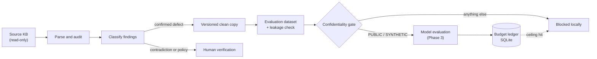
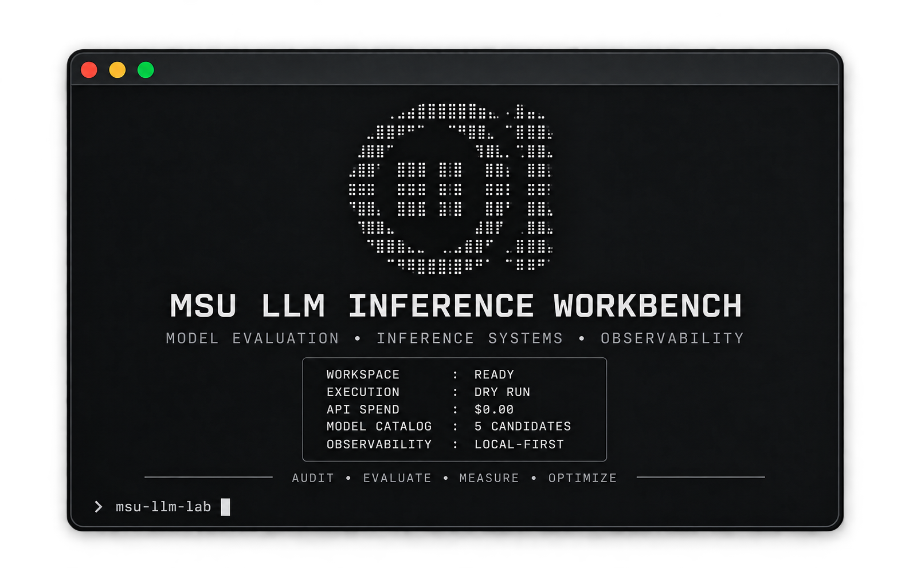

<div align="center">

# MSU LLM Inference Workbench

**Fix the knowledge base first. Then pick the model. Then prove you can serve it.**

The local-first framework for evaluating the language models behind a university admissions counsellor, with a hard spend cap and zero outbound network calls.

<br />


[Why](#why-msu-llm-workbench) · [Quick start](#quick-start) · [How it works](#how-it-works) · [Commands](#command-reference) · [Safety](#designed-for-sensitive-data) · [Roadmap](#roadmap)

</div>

---

## Why MSU LLM Workbench?

Management and Science University (MSU), Malaysia runs an AI counsellor that answers questions about programmes, entry requirements, fees and procedures. Teams usually respond to bad answers by swapping models. Often the model was never the problem.

A question about "Bachelor in Accounting" sitting inside the Broadcasting section, or a PhD fee quoted as both RM62,500 and RM63,500 in a single answer, will make any model hallucinate.

MSU LLM Workbench is built around that observation:

- **Audit the knowledge base** for structural defects, duplicates and contradictory figures before they reach a model.
- **Build leak-free evaluation datasets** with strict confidentiality labels and train/dev/test separation.
- **Compare candidate models** on accuracy, groundedness, latency and cost, under a local budget that cannot be exceeded by accident.
- **Investigate self-hosted serving** with vLLM: throughput, time-to-first-token and KV-cache pressure.

Everything runs against local files and SQLite. No API keys, no telemetry, no network.

---

## Quick start

Requires Python 3.11+ and [`uv`](https://github.com/astral-sh/uv) (or plain `pip`).

```bash
git clone https://github.com/Sudharsanselvaraj/Model-Systems-Workbench.git
cd Model-Systems-Workbench
uv sync                                   # or: pip install -e ".[dev]"
```

Open the dashboard:

```bash
uv run msu-llm-lab ui
```

Audit a knowledge base without touching it:

```bash
uv run msu-llm-lab audit-kb "path/to/kb.md" --dry-run
```

Check your spend against the policy ceilings:

```bash
uv run msu-llm-lab budget status
```

### Remediate, safely

```bash
# Preview what would change
uv run msu-llm-lab remediate-kb "path/to/kb.md"

# Write a versioned clean copy; the original is never modified
uv run msu-llm-lab remediate-kb "path/to/kb.md" \
  --apply --output data/remediated/MSU_Programmes_KB_v1.1_clean.md
```

### Validate an evaluation dataset

```bash
uv run msu-llm-lab validate-dataset data/evaluation/synthetic_seed_eval.jsonl
```

---

## How it works



1. **Parse.** Escaped markdown such as `\*\*Question:\*\*` is normalized into structured question/answer records, with headings and orphan lines tracked.
2. **Audit.** Deterministic and heuristic validators flag defects, each with a stable issue code, line range and suggested action.
3. **Classify.** Findings become confirmed defects, contradictions, intake-date policy items, curriculum rules or duplicates. Only confirmed defects are auto-fixed.
4. **Verify.** Every audit and remediation hashes the source file with SHA-256 before and after. Any difference aborts with exit code `2`.
5. **Build datasets.** Evaluation cases carry confidentiality labels and are checked for cross-split leakage.
6. **Gate and spend.** Only `PUBLIC` or `SYNTHETIC` records may leave the machine, and only while the local ledger has budget left.

### What the audit checks

| Issue code | Catches |
|---|---|
| `MISSING_ANSWER_TAG`, `ORPHAN_ANSWER_TAG` | Questions without answers, answers without questions |
| `EMPTY_QUESTION_CONTENT`, `EMPTY_ANSWER_CONTENT` | Tags present, content missing |
| `REPETITIVE_ANSWER_MARKERS`, `STRAY_TOKEN`, `STRAY_TEXT` | Malformed or duplicated markers and loose text |
| `EMPTY_HEADING` | Section headers with no title |
| `DUPLICATE_QUESTION_EXACT`, `DUPLICATE_QUESTION_NORMALIZED` | Verbatim and near-verbatim repeats |
| `CONFLICTING_TUITION_FEES` | Different RM figures within one answer |
| `SUSPICIOUS_PROGRAMME_MISMATCH` | Question names one programme, section or answer another |
| `TIME_SENSITIVE_CONTENT` | Intake months, deadlines and year references that go stale |

### How findings are handled

| Classification | Example | Action |
|---|---|---|
| `CONFIRMED_CONTENT_DEFECT` | Accounting question under the Broadcasting section | Fixed in a clean copy |
| `CONTRADICTORY_FACT` | PhD fee quoted as RM62,500 and RM63,500 | Blocked until officially verified |
| `POLICY_INTAKE_DATE` | Intake months and years from 2022 to 2025 | Flagged for the admissions calendar |
| `CURRICULUM_MPU_RULE` | MUET Band 3 vs Band 4 across faculties | Escalated to the KB owner |
| `DUPLICATE_ENTRY` | Same question repeated across programmes | Investigated before merging |

The system never silently picks a number. If two facts disagree, a human decides.

---

## Command reference

| Command | Purpose |
|---|---|
| `msu-llm-lab ui` | Full-screen terminal dashboard: health, models, audit findings, spend |
| `msu-llm-lab audit-kb <file>` | Audit a KB. `--dry-run` for a summary only, `--output-dir` for CSV and Markdown reports |
| `msu-llm-lab remediate-kb <file>` | Preview or apply confirmed fixes. `--apply --output <path>` writes a versioned copy |
| `msu-llm-lab validate-dataset <file>` | Check evaluation cases for confidentiality labels and split leakage |
| `msu-llm-lab budget status` | Spend against pilot, total, per-run and per-case ceilings |
| `msu-llm-lab models list` | Candidate model portfolio from the local database |

Dashboard keys: `Tab` / `Shift+Tab` switch tabs, `j` / `k` or arrows navigate, `b` opens the spend ledger, `r` refreshes, `q` quits.

---

## Designed for sensitive data

This tool handles a university's internal knowledge base, so safety is structural rather than optional.

- **Read-only sources.** Source files are hashed before and after every command. Remediation always writes a separate file.
- **No guessing.** Contradictory facts are escalated, never auto-resolved.
- **Fail closed.** `UNCLASSIFIED`, `INTERNAL` and `CONFIDENTIAL` records are blocked before any future external call. Only `PUBLIC` and `SYNTHETIC` are eligible.
- **Spend ceilings.** Local limits stop work before a provider account is touched:

  | Limit | Default |
  |---|--:|
  | Total experiment ceiling | `$10.00` |
  | Pilot ceiling | `$2.00` |
  | Per-run cap | `$0.50` |
  | Per-case cap | `$0.02` |

- **No secrets in git.** `.env`, keys, `data/`, `reports/`, SQLite files and the MSU knowledge-base files are git-ignored.
- **Exact money.** Costs use `Decimal` arithmetic and integer micro-dollars, never floats.

> [!NOTE]
> Budget ceilings are local governance limits, not provider-enforced balances. Also set hard limits in your provider dashboard.

---

## Preview

<div align="center">

</div>

---

## Candidate models

All entries are `UNVERIFIED_CATALOG_ENTRY`: planning baselines with preliminary pricing that have not been called against any live API.

| Model | Role | Deployment | $/1M in / out |
|---|---|---|--:|
| `google/gemini-3.5-flash-lite` | High-throughput triage baseline | Hosted direct | 0.075 / 0.30 |
| `anthropic/claude-haiku-5.5` | Fast hosted reasoning candidate | OpenRouter | 0.80 / 4.00 |
| `openai/gpt-6-luna` | Quality-ceiling reference | OpenRouter | 0.15 / 0.60 |
| `qwen/qwen3-8b` | Primary open-weight candidate | OpenRouter, then vLLM | 0.20 / 0.20 |
| `qwen/qwen3-14b` | Capacity and reasoning comparison | OpenRouter, then vLLM | 0.35 / 0.40 |

---

## Roadmap

| Phase | Scope | Status |
|:--:|---|:--:|
| 0 | Discovery and architecture | Done |
| 1 | KB audit, remediation, budget ledger, model catalog, TUI | Done |
| 2 | Evaluation schemas, confidentiality gate, splits, n-gram leakage detector | Done |
| 3 | OpenRouter provider with retry and backoff, secret scrubbing, dry-run mode, model comparison | Next |
| 4 | Redacted Langfuse trace ingestion and failure classification (routing, retrieval, generation, KB) | Planned |
| 5 | LoRA / QLoRA feasibility and GPU sizing | Planned |
| 6 | vLLM benchmarks: TTFT, throughput and KV-cache pressure at 1, 5, 10 and 25 concurrent users | Planned |
| 7 | Research dashboard with latency-versus-quality frontiers | Planned |

Detailed acceptance criteria live in [`docs/IMPLEMENTATION_PLAN.md`](docs/IMPLEMENTATION_PLAN.md).

---

## Project layout

```text
src/msu_llm_lab/
├── cli.py              # Typer entry point
├── audit/              # parser, validator, reporter, issue models
├── remediation/        # engine, curated findings registry, models
├── core/               # config and budget policy, budget service
├── storage/            # SQLite manager (ledger and model portfolio)
├── models/             # candidate model catalog
└── tui/                # app loop, screens, health, telemetry, theme
tests/                  # audit, budget, remediation, TUI
docs/                   # architecture, implementation plan, project map
```

---

## Development

```bash
uv run pytest
```

> [!IMPORTANT]
> The MSU knowledge-base files are confidential and git-ignored. Three tests hash or remediate those exact files (`test_remediation_engine_dry_run_preserves_source_hash`, `test_remediation_cli_command`, `test_health_checks_live`) and will fail without them. Everything else runs offline against an in-memory database.

### Contributing

Issues and pull requests are welcome, especially for validator heuristics and the Phase 3 provider layer.

1. Open an issue before starting large changes.
2. Add tests for every new validator or remediation rule.
3. Never commit data from the real knowledge base.

### Documentation

| Doc | Contents |
|---|---|
| [`ARCHITECTURE.md`](docs/ARCHITECTURE.md) | Design, data flow, security boundaries |
| [`IMPLEMENTATION_PLAN.md`](docs/IMPLEMENTATION_PLAN.md) | Phases, acceptance criteria, milestones |
| [`PROJECT_MAP.md`](docs/PROJECT_MAP.md) | Workspace inventory, data quirks, counting method |

---

## License

An internal research tool for evaluating and optimizing the MSU admissions language-model system. Source knowledge-base documents remain the property of MSU. Open-source licensing for the tooling is under review.
