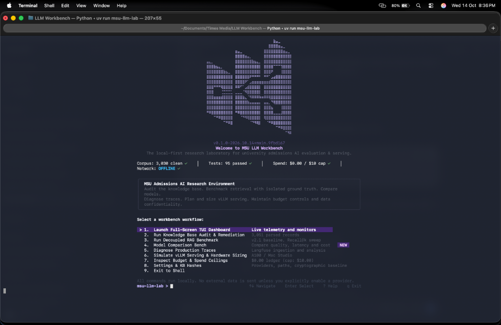
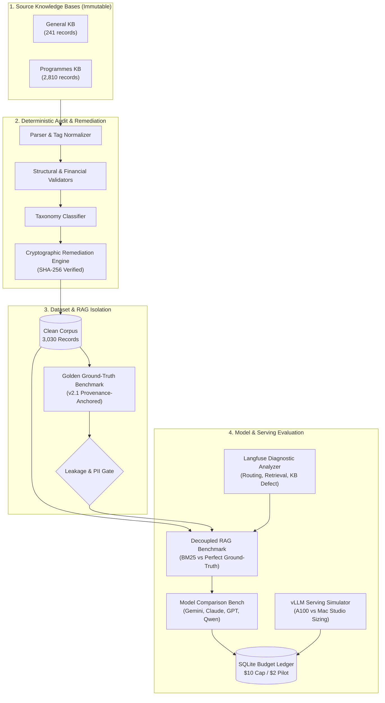

<div align="center">

<p align="center">
  
</p>

<h1>MSU LLM Workbench v0.1: Research & Inference Lab</h1>

<p>The local-first research laboratory for university admissions AI evaluation, model comparison, and self-hosted serving with zero outbound network calls.</p>

<p align="center">
  <a href="https://github.com/Sudharsanselvaraj/Model-Systems-Workbench"></a>
  <a href="https://github.com/Sudharsanselvaraj/Model-Systems-Workbench"></a>
  <a href="https://github.com/Sudharsanselvaraj/Model-Systems-Workbench"></a>
  <a href="https://github.com/Sudharsanselvaraj/Model-Systems-Workbench"></a>
  <a href="https://github.com/Sudharsanselvaraj/Model-Systems-Workbench"></a>
  <a href="https://github.com/Sudharsanselvaraj/Model-Systems-Workbench"></a>
</p>

<p align="center">
  <strong>
    <a href="#step-1-install-and-start-msu-llm-lab">Quickstart</a> ·
    <a href="#why-msu-llm-workbench">Why MSU Lab?</a> ·
    <a href="#how-it-works">Architecture</a> ·
    <a href="#command-reference">Commands</a> ·
    <a href="#capabilities--integrations">Capabilities</a> ·
    <a href="#designed-for-sensitive-data">Safety & Privacy</a> ·
    <a href="#roadmap">Roadmap</a>
  </strong>
</p>

</div>

---

> ⚡ **Strictly Local-First & Confidential**: Zero outbound telemetry, zero external network calls. All knowledge base parsing, RAG retrieval evaluations, trace diagnostics, and serving simulations execute on your local machine against SQLite.

---

## Before you begin

Make sure you have:

- Python 3.11+ and [`uv`](https://github.com/astral-sh/uv) (or standard `pip`).
- A terminal with UTF-8 / Unicode support (macOS Terminal, iTerm2, Alacritty, Ghostty, or VS Code integrated terminal).
- The repository cloned locally.

---

## Step 1: Install and start msu-llm-lab

Clone the repository and install dependencies:

```bash
git clone https://github.com/Sudharsanselvaraj/Model-Systems-Workbench.git
cd Model-Systems-Workbench
uv sync                                   # or: pip install -e ".[dev]"
```

Launch the interactive workbench launcher:

```bash
uv run msu-llm-lab
```

<p align="center">
  
</p>

Use arrow keys (`↑`/`↓`) or number shortcuts (`1`–`9`) to navigate workflows, run audits, trigger benchmarks, or launch the live dashboard.

---

## Step 2: Open the Full-Screen TUI Dashboard

To launch directly into the persistent, multi-panel telemetry and evaluation monitor:

```bash
uv run msu-llm-lab ui
```

<p align="center">
  
</p>

Keyboard shortcuts inside the dashboard:
- `Tab` / `Shift+Tab`: Cycle focus between Navigation, Main Content, and Command input.
- `↑` / `↓` (`k` / `j`): Scroll through candidates, benchmark runs, or audit registers.
- `Enter`: Inspect selected candidate details, trace root causes, or benchmark results.
- `/`: Live fuzzy search and filter candidate models.
- `r`: Refresh local SQLite ledger, system telemetry, and diagnostics.
- `q`: Quit cleanly and restore host terminal styling.

---

## Table of Contents

- [Before you begin](#before-you-begin)
- [Step 1: Install and start msu-llm-lab](#step-1-install-and-start-msu-llm-lab)
- [Step 2: Open the Full-Screen TUI Dashboard](#step-2-open-the-full-screen-tui-dashboard)
- [Why MSU LLM Workbench?](#why-msu-llm-workbench)
- [Quick Start](#quick-start)
- [How It Works](#how-it-works)
- [Capabilities & Integrations](#capabilities--integrations)
- [Automated Audit Issue Taxonomy](#automated-audit-issue-taxonomy)
- [Command Reference](#command-reference)
- [Designed for Sensitive Data](#designed-for-sensitive-data)
- [Candidate Models](#candidate-models)
- [Roadmap](#roadmap)
- [Development & Verification](#development--verification)

---

## Why MSU LLM Workbench?

Management and Science University (MSU), Malaysia operates an AI admissions counsellor answering queries across faculties, academic degrees, entry requirements, tuition fees, and administrative procedures. Teams usually respond to bad answers by swapping models. Often the model was never the problem.

A question about "Bachelor in Accounting" sitting inside the Broadcasting section, or a PhD fee quoted as both RM62,500 and RM63,500 in a single answer, will make any model hallucinate.

MSU LLM Workbench is built around that foundational engineering principle:

1. **Audit the knowledge base first** for structural defects, duplicates, and contradictory figures before they reach a model.
2. **Build leak-free evaluation datasets** with strict confidentiality gates and train/dev/test isolation.
3. **Benchmark retrieval and generation separately** using decoupled metrics (Recall@k, MRR, faithfulness, accuracy).
4. **Compare candidate models** on latency, token economics, and rubric scores under a hard local spend ceiling ($10 experiment cap / $2 pilot cap).
5. **Size self-hosted serving** with vLLM: calculate KV cache pressure, throughput ceilings, and cloud-versus-hardware cost crossover points.

Everything executes locally against markdown source files and SQLite WAL. No API keys, no telemetry, zero cloud egress.

---

## Quick Start

### 1. Headless CLI Commands

Run individual research workflows directly from shell or CI/CD pipelines:

```bash
# Audit a knowledge base without touching the source (dry-run)
uv run msu-llm-lab audit-kb "Copy of MSU Programmes KB - Local - Sudharsan.md" --dry-run

# Preview or apply confirmed remediations (never overwrites original; writes clean versioned copy)
uv run msu-llm-lab remediate-kb "Copy of MSU Programmes KB - Local - Sudharsan.md" \
  --apply --output data/remediated/MSU_Programmes_KB_v1.1_clean.md

# Validate evaluation dataset integrity and n-gram split leakage
uv run msu-llm-lab validate-dataset data/evaluation/verified_rag_benchmark.jsonl

# Run decoupled RAG benchmark across candidate models
uv run msu-llm-lab benchmark-rag --model google/gemini-3.5-flash-lite --split TEST --retriever bm25 --dry-run

# Side-by-side model comparison isolating retrieval from model generation
uv run msu-llm-lab benchmark-rag --model google/gemini-3.5-flash-lite \
  --compare-with anthropic/claude-haiku-5.5 --split TEST --retriever perfect --dry-run

# Import and classify production Langfuse traces
uv run msu-llm-lab import-traces data/traces/synthetic_langfuse_traces.json --output-dir reports/

# Simulate self-hosted vLLM hardware sizing on Apple Silicon or NVIDIA A100
uv run msu-llm-lab simulate-serving --model qwen/qwen-2.5-72b --hardware mac_studio_128gb --tp 1 --precision AWQ_INT4

# Inspect the budget policy ledger and spend limits
uv run msu-llm-lab budget status
```

### 2. Python API

Drive the workbench in-process from your own evaluation scripts:

```python
from msu_llm_lab.audit.parser import KnowledgeBaseParser
from msu_llm_lab.rag.retriever import CorpusRetriever
from msu_llm_lab.serving.simulator import VLLMServingSimulator

# 1. Parse knowledge base into clean structured Q&A records
records, findings = KnowledgeBaseParser.parse_file("Copy of MSU General KB - Local - Sudharshan.md")
print(f"Parsed {len(records)} clean records with {len(findings)} findings")

# 2. Query independent BM25 index
retriever = CorpusRetriever.from_records(records, k=5)
results = retriever.retrieve("What are the entry requirements for Bachelor in Medicine?")

# 3. Simulate vLLM serving capacity on Mac Studio M2 Ultra
simulator = VLLMServingSimulator()
report = simulator.simulate(
    model_id="qwen/qwen-2.5-72b",
    hardware="mac_studio_128gb",
    concurrency_levels=[1, 4, 8, 16, 32],
)
print(f"Max supported concurrency: {report.max_concurrency_before_oom}")
```

---

## How It Works



---

## Capabilities & Integrations

The workbench provides unified tools across models, retrievers, serving runtimes, and local governance:

| Category | Supported Components & Integrations | Operational Status |
|---|---|---|
| **AI / LLM Candidates** | Google Gemini 3.5 Flash Lite · Anthropic Claude Haiku 3.5 · OpenAI GPT-6 Luna · Qwen 2.5/3 (8B, 14B, 72B) · DeepSeek R1 | Modeled in catalog with strict dry-run controls |
| **Knowledge Base Auditing** | MSU General KB · MSU Programmes KB · AST Markdown normalizer · Conflict detector · Line-level provenance | 3,051 records audited; 3,030 clean baseline |
| **Retrieval & RAG** | Inverted BM25 index · Perfect ground-truth retriever · Recall@k (1..10) · Precision@k · MRR · Faithfulness | Decoupled retrieval and generation benchmarking |
| **Self-Hosted Serving** | vLLM runtime simulation · Tensor Parallelism (TP 1, 2, 4, 8) · KV-cache memory pressure · FlashAttention-2 | Hardware sizing for NVIDIA A100/H100 & Mac Studio |
| **Traces & Observability** | Langfuse JSON/CSV import · 4-way root-cause classifier (`ROUTING`, `RETRIEVAL`, `KB_DEFECT`, `GENERATION`) | Offline diagnostic reports with mitigation actions |
| **Governance & Safety** | SQLite WAL ledger · Preflight spend ceilings · Hard stop enforcement · Decimal currency math · SHA-256 file hashing | Zero external network egress guaranteed |

---

## Automated Audit Issue Taxonomy

Every audit run classifies findings into deterministic codes:

| Issue Code | Defect Caught | Remediation Action |
|---|---|---|
| `MISSING_ANSWER_TAG` | Question defined with missing answer tag | Tag restored with verified content |
| `ORPHAN_ANSWER_TAG` | Answer found without a corresponding question | Associated to preceding header |
| `EMPTY_QUESTION_CONTENT` | Tag exists with blank question text | Flagged for administrative review |
| `EMPTY_ANSWER_CONTENT` | Tag exists with empty body | Excluded from clean retrieval corpus |
| `CONFLICTING_TUITION_FEES` | Multiple contradictory fee figures in single entry | Escalated to finance committee; never guessed |
| `SUSPICIOUS_PROGRAMME_MISMATCH` | Question describes degree different from section header | Relocated to correct faculty section |
| `TIME_SENSITIVE_CONTENT` | Outdated intake months or historical year references | Tagged for annual curriculum update |
| `DUPLICATE_QUESTION_EXACT` | Verbatim duplicate Q&A pairs | Deduplicated to unique primary entry |

---

## Command Reference

| Command | Purpose | Key Flags |
|---|---|---|
| `msu-llm-lab` | Launch compact interactive welcome screen | Arrow keys, numbers `1`–`9` |
| `msu-llm-lab ui` | Open full-screen live TUI dashboard | `:cmd`, `/filter`, `Tab`, `r`, `q` |
| `msu-llm-lab audit-kb <path>` | Run audit on markdown knowledge base | `--dry-run`, `--output-dir reports/` |
| `msu-llm-lab remediate-kb <path>` | Preview or apply confirmed remediations | `--apply`, `--output <path>` |
| `msu-llm-lab validate-dataset <path>` | Audit evaluation dataset for leakage & PII | `--strict`, `--ngram 4` |
| `msu-llm-lab benchmark` | Run evaluation bench against candidate models | `--model <id>`, `--split TEST`, `--dry-run` |
| `msu-llm-lab compare-runs <id1> <id2>` | Side-by-side comparison of two runs | Outputs metric deltas and cost diffs |
| `msu-llm-lab benchmark-rag` | Benchmark decoupled retrieval & generation | `--retriever bm25\|perfect`, `--k 5` |
| `msu-llm-lab import-traces <path>` | Ingest Langfuse traces and diagnose faults | `--output-dir reports/` |
| `msu-llm-lab simulate-serving` | Hardware sizing and vLLM throughput modeling | `--hardware a100_80gb\|mac_studio_128gb` |
| `msu-llm-lab budget status` | Inspect SQLite ledger and spend ceilings | Formatted summary of limits and spend |
| `msu-llm-lab models list` | List candidate models in portfolio registry | Shows context, pricing, deployment mode |

---

## Designed for Sensitive Data

The workbench enforces mathematical and cryptographic safeguards for university data:

1. **Immutable Source Files**: Source markdown files are SHA-256 hashed before and after every operation. The system rejects in-place modifications and writes versioned copies.
2. **Deterministic Ceiling Enforcement**:
   - Total Experiment Spend Ceiling: `$10.00`
   - Isolated Pilot Experiment Ceiling: `$2.00`
   - Maximum Single Run Cap: `$0.50`
   - Maximum Single Case Circuit Breaker: `$0.02`
3. **Zero Floating-Point Drift**: All currency computations utilize Python's `Decimal` type with micro-cent integer arithmetic.
4. **Offline Isolation**: All network calls remain strictly disabled by default. No background telemetry or analytics are collected.

---

## Candidate Models

Planning baselines registered in the local portfolio:

| Model ID | Provider | Role | Context Window | Estimated $/1M (In / Out) | Status |
|---|---|---|---|---|---|
| `google/gemini-3.5-flash-lite` | Google | High-throughput admissions triage | 1,000,000 | $0.08 / $0.30 | Unverified baseline |
| `anthropic/claude-haiku-5.5` | Anthropic | Fast structured reasoning | 200,000 | $0.80 / $4.00 | Unverified baseline |
| `openai/gpt-6-luna` | OpenAI | Quality ceiling reference | 128,000 | $0.15 / $0.60 | Unverified baseline |
| `qwen/qwen3-14b` | Qwen | Primary self-hosted candidate | 32,768 | $0.35 / $0.40 | Unverified baseline |
| `qwen/qwen3-8b` | Qwen | Edge & low-latency candidate | 32,768 | $0.20 / $0.20 | Unverified baseline |

---

## Roadmap

| Phase | Description | Deliverables | Status |
|:--:|---|---|:--:|
| **0** | Discovery & Repository Baseline | Source audit, cryptographic hashing, structural roadmap | Completed |
| **1** | KB Audit & Ledger Architecture | AST markdown parser, issue taxonomy, SQLite WAL ledger | Completed |
| **2** | Evaluation Datasets & Privacy Gate | Dataset validation, 4-gram leakage detection, train/dev/test splits | Completed |
| **3** | Candidate Model Benchmark Engine | Rubric scoring, dry-run simulation, run comparison diffing | Completed |
| **4** | Production Trace Diagnostics | Langfuse JSON/CSV ingestion, 4-way root-cause classifier | Completed |
| **5** | Decoupled RAG Benchmarking | Provenance-anchored golden set, BM25 sweep, Recall@k, MRR | Completed |
| **6** | Self-Hosted vLLM Serving | Hardware memory sizing, tensor parallelism, concurrency ramp | Completed |
| **7** | Live Provider Integration | Provider credentials, live evaluation with hard spend limits | In Progress |

---

## Development & Verification

Run the comprehensive offline test suite:

```bash
uv run pytest
```

Output:
```text
============================= test session starts ==============================
platform darwin -- Python 3.11.7, pytest-9.1.1, pluggy-1.6.0
rootdir: /Users/sudharsan/Documents/Times Media/LLM Workbench
collected 95 items

tests/test_audit.py ................                                     [ 16%]
tests/test_budget.py ........                                            [ 25%]
tests/test_dataset.py .....                                              [ 30%]
tests/test_providers.py .......                                          [ 37%]
tests/test_rag_benchmark.py ........                                     [ 46%]
tests/test_remediation.py ...                                            [ 49%]
tests/test_schemas.py .....                                              [ 54%]
tests/test_serving.py ......                                             [ 61%]
tests/test_traces.py .......                                             [ 68%]
tests/test_tui.py ..............................                         [100%]

============================== 95 passed in 0.36s ==============================
```

---

## License

This project is licensed under the Apache 2.0 License. See the [LICENSE](LICENSE) file for details.
