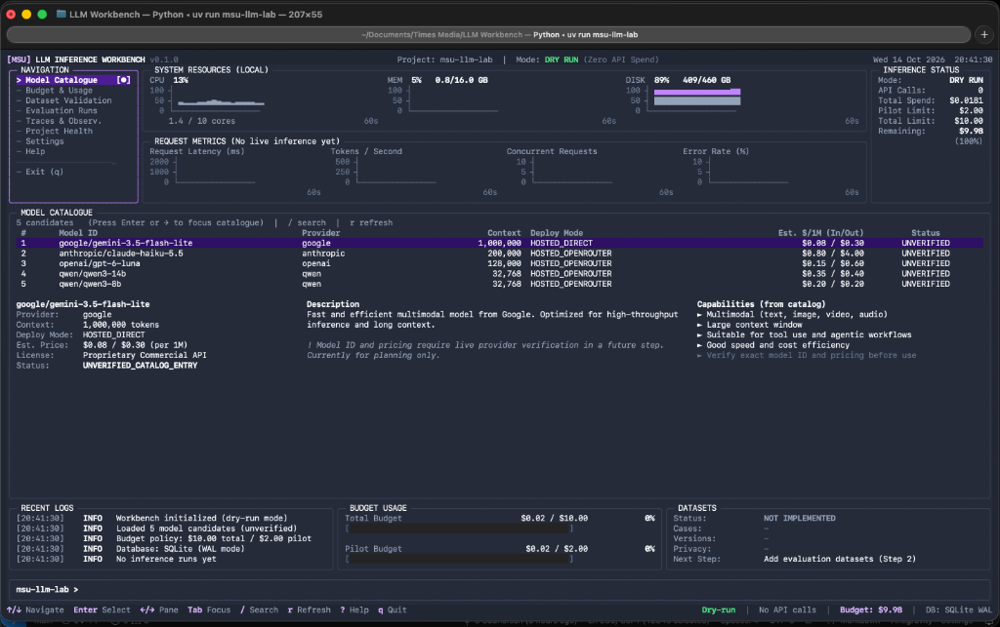

<div align="center">


# MSU LLM Workbench

**Fix the knowledge base before you blame the model.**

A local-first research workbench for auditing admissions knowledge bases, preparing classification datasets from real conversations, and comparing candidate models on real requests under hard spend caps.

<p>
  
  
  
  
</p>

<p>
  <a href="#quickstart"><b>Quickstart</b></a> ·
  <a href="#why-this-exists"><b>Why</b></a> ·
  <a href="#commands"><b>Commands</b></a> ·
  <a href="#safety-model"><b>Safety</b></a> ·
  <a href="#comparison-roster"><b>Roster</b></a> ·
  <a href="#development"><b>Development</b></a> ·
  <a href="docs/ARCHITECTURE.md"><b>Docs</b></a>
</p>

</div>

> [!NOTE]
> **Alpha.** The workbench contains no simulated or mock mode: every model response it records came from a provider, and a request is only ever sent after you type approval of the exact plan. No live request has been made yet. **Production parity is not established** (the Dify workflow export is missing), and no provider data policy is verified, so student-derived data may not be sent to any provider.

<p align="center">
  
</p>

---

## Why this exists

An admissions chatbot gives a wrong answer. The usual reaction is to swap the model. Often the model was never the problem:

- A *Bachelor in Accounting* question filed under the *Broadcasting* section.
- A PhD fee quoted as both **RM62,500** and **RM63,500** in one answer.
- A question with no answer tag at all, so retrieval has nothing to ground on.

No model fixes that. This workbench is built around the opposite order of operations:

| # | Step | What you get |
|:-:|---|---|
| 1 | **Audit the KB first** | Structural defects, duplicates and conflicting figures, found deterministically |
| 2 | **Prepare classification data locally** | Redacted, session-reconstructed, leakage-safe candidate cases for the intent and lead-qualification classifiers, with every label left for human review |
| 3 | **Compare models on identical inputs** | Ten participants with sourced prices, routes and readiness; strict output validators; confidence captured only where a provider returns it |
| 4 | **Spend under hard caps** | Preflight bounds, per-case circuit breaker, a ledger that separates actual, estimated and unresolved spend |

---

## Quickstart

**You need:** Python 3.11+, [`uv`](https://github.com/astral-sh/uv) (or `pip`), and a Unicode-capable terminal.

```bash
git clone https://github.com/Sudharsanselvaraj/Model-Systems-Workbench.git
cd Model-Systems-Workbench
uv sync                        # or: pip install -e ".[dev]"
uv run msu-llm-lab             # interactive launcher; returns to the menu after each workflow
```

<p align="center">
  
</p>

Navigate with `↑`/`↓` (or `j`/`k`), pick a workflow with `Enter` or its number, and leave with `9`, `q` or `Esc`.

### Before any live request

```bash
uv run msu-llm-lab models roster       # all ten participants: readiness, routes, blockers, data-policy status
uv run msu-llm-lab api-preflight       # is OPENROUTER_API_KEY set? (never shows it; sends nothing)
uv run msu-llm-lab smoke-test          # prints the exact plan: models, routes, cases, prices, cost bound, hard cap
```

Set the key in your own shell, never in chat or a file you commit: `export OPENROUTER_API_KEY=...`. `smoke-test --live` then asks you to type an approval phrase that includes the plan fingerprint; it refuses in a non-interactive terminal.

> [!IMPORTANT]
> The real MSU knowledge bases, conversation export and production prompt files are confidential and **git-ignored** (`Copy of MSU *.md`, `september_to_october.csv`, `main_intent_classifier.md`, `lead_qualification_prompt.md`, `data/*`, `reports/`). Commands that need them (`audit-kb`, `prepare-classification-data`, `smoke-test`) need your own copies.

### Full-screen dashboard

```bash
uv run msu-llm-lab ui
```

<p align="center">
  
</p>

A read-only experimental dashboard: execution state and spend by kind (ACTUAL, ESTIMATED, UNRESOLVED, legacy simulated) in the header; local CPU/memory/disk; request graphs drawn only from recorded request events (`NO LIVE INFERENCE YET` until some exist); and six experimental categories (classification quality, confidence and calibration, model agreement, Lead Qualifier, live latency and cost, robustness and readiness) plus dataset review. Supervised metrics stay `GROUND TRUTH PENDING` until human-approved labels exist. See [docs/LIVE_DASHBOARD.md](docs/LIVE_DASHBOARD.md).

| Key | Action |
|---|---|
| `1`-`9` `0` `-` `=` / `[` `]` | Jump to a section / step through all 16 |
| `Tab` / `Shift+Tab` | Cycle focus between panels |
| `↑` `↓` / `k` `j`, `Home` `End` | Move through rows |
| `Enter` | Inspect the selected item (wide terminals show a side inspector) |
| `/` | Filter the roster |
| `:` | Command line (`:overview`, `:quality`, `:calibration`, `:agreement`, `:lead`, `:latency`, `:robustness`, `:labels`, `:budget`, `:eval`, `:audit`, `:help`, `:quit`) |
| `r` | Re-read telemetry, ledger and local files (the dashboard also re-polls every 2 s when idle) |
| `q` | Quit and restore the terminal |

The dashboard cannot start a live run; those go through the CLI with typed approval. Optional: `pip install "msu-llm-lab[monitor]"` adds `psutil` for true CPU and memory readings.

---

## Commands

| Command | Purpose |
|---|---|
| `msu-llm-lab` | Interactive launcher |
| `ui` | Full-screen dashboard |
| `models roster` / `models list` | Comparison roster with exact blockers |
| `api-preflight` | Key present? (no request) |
| `smoke-test [--model ... --stage smoke\|pilot --hard-cap N --live]` | Synthetic-fixture plan and approved run for the adapters; plan only unless `--live` |
| `prepare-classification-data [--new-version]` | Clean, redact and prepare the conversation export locally; refuses to overwrite an existing preparation |
| `real-benchmark plan\|run\|status\|report` | Authorized real-data benchmark across the roster: plan-only planning, two typed approvals, checkpointed execution, report (see docs/REAL_BENCHMARK.md) |
| `annotate queue\|submit\|status\|adjudicate\|approve\|revoke\|freeze` | Independent annotation, adjudication, named approval and freezing of ground-truth labels |
| `classification-data-status` | Counts for any prepared dataset (no student text) |
| `export-traces [-f jsonl\|csv\|zip --model --run --task --status]` | Redacted local export of stored trace records to `reports/exports/` (see docs/LIVE_DASHBOARD.md) |
| `audit-kb <path> [--dry-run]` | Audit a markdown KB (`--dry-run` previews without writing reports) |
| `remediate-kb [path] [--apply]` | Preview, or write, a versioned clean copy; the source is never overwritten |
| `validate-dataset [path] [--check-leakage]` | Dataset integrity, classification and leakage |
| `benchmark --live` | Generation benchmark with real requests (typed approval) |
| `benchmark-rag --live [-k N -c MODEL]` | Retrieval-plus-generation benchmark with real requests over a BM25 index of the audited KB |
| `compare-runs <a> <b>` | Diff two recorded runs |
| `import-traces <path>` | Ingest and diagnose a redacted Langfuse export |
| `budget status` | Spend, ceilings, unresolved entries |
| `budget reconcile --transaction-id ... --amount-usd ...` | Resolve an unresolved-spend entry with a dashboard figure |
| `budget purge-simulated` | One-time clean-up of simulated rows left by older versions (backs the database up first) |

Run any command with `--help`.

---

## Safety model

Built for confidential university data. These invariants are enforced in code and covered by tests.

1. **Real requests only, with typed approval.** There is no dry-run or mock generation anywhere. A request is sent only after an interactive terminal user types the exact phrase for the plan (including its fingerprint). Piped or non-interactive input is refused.
2. **Fail-closed data gate.** Only `PUBLIC` and `SYNTHETIC` cases may be dispatched. Real conversation cases are `CONFIDENTIAL`, and no provider data policy is verified, so student-derived data stays local.
3. **Immutable sources.** Source KBs and the conversation export are hashed before and after each operation and never modified.
4. **Spend caps** (local policy, not provider-enforced; also set a credit limit on your OpenRouter key):

   | Rule | Limit |
   |---|---|
   | Total experiment ceiling | `$10.00` |
   | Pilot ceiling | `$2.00` |
   | Max single run | `$0.50` (preflight rejects the run) |
   | Max single case | `$0.02` (circuit breaker halts the run) |

5. **Honest accounting.** Spend is booked as provider-reported, catalog-estimated or manually reconciled, and kept apart. A request whose cost cannot be established becomes an *unresolved-spend* entry that blocks further live runs until reconciled. Provider `usage.cost` is "credits" with no stated USD ratio, so it is kept as a native value and not booked as USD.
6. **Nothing is invented.** Missing tokens, latency or confidence stay null. A prediction is never ground truth. Every derived dataset states `PRODUCTION_PARITY_NOT_ESTABLISHED`.
7. **Privacy limits are visible.** Redaction is pattern-based (no named-entity recognition) and pseudonyms are salted hashes, not anonymisation; every derived file carries that notice.

---

## Comparison roster

Ten participants: two reported production baselines (evaluated through OpenRouter benchmark routes that are *not* verified to match Dify), six candidates and two frontier references. `msu-llm-lab models roster` shows each one's role, supported tasks, pinned provider route (no silent fallback), sourced price, readiness and exact blockers. Facts carry their source URL and check date; anything not verified is shown as `UNKNOWN`. Jev uses OpenRouter's Decisions API through its own adapter; every other model uses the chat-completions adapter.

## Classification data preparation

`prepare-classification-data` reads the export read-only, drops `user4` entirely, replaces identifiers with salted hashes, redacts contact details and explicitly introduced names, flags (never deletes) duplicates, and rebuilds sessions under two provisional gap thresholds (30 minutes and 2 hours; neither is chosen). It writes separate Main Intent and Lead Qualifier candidate sets with all expected labels null, a group-level split with no user crossing splits, and a manifest with counts and the code version. See [docs/DATASET_CLEANING.md](docs/DATASET_CLEANING.md).

---

## Project layout

```text
src/msu_llm_lab/
├── cli.py              # Typer entry point and launcher loop
├── audit/              # KB parser, validators, reporter
├── remediation/        # SHA-256-guarded clean-copy engine
├── schemas/            # Pydantic: cases, executions, scoring
├── dataset/            # JSONL manager and leakage detector
├── providers/          # provider base, shared bounded-retry HTTP, OpenRouter adapter
├── evaluation/         # generation benchmark runner and rubric evaluator
├── rag/                # BM25 retriever over the audited KB, decoupled benchmark
├── classification/     # contracts, validators, lead-summary builder, Jev/chat adapters, runner, smoke test, data preparation
├── models/             # sourced participant registry and legacy planning catalogue
├── traces/             # Langfuse importer and failure classifier
├── core/               # config, budget service, live-run authorization
├── observability/      # request-event log, aggregation, label loader, prediction analysis, live monitor
├── storage/            # SQLite (WAL) ledger and run history
└── tui/                # launcher and dashboard
tests/                  # unit, integration and pseudo-terminal tests
docs/                   # architecture, dataset cleaning, decisions
```

## Development

```bash
uv sync
uv run pytest
```

The suite uses only hand-written fixtures and fake transports (sockets are blocked in the classification tests); it never touches your real database. A few tests rely on git-ignored local files (knowledge bases, trace fixtures, prompt files) and skip or fail on a clean public clone.

## License

Apache 2.0. See [`LICENSE`](LICENSE).
