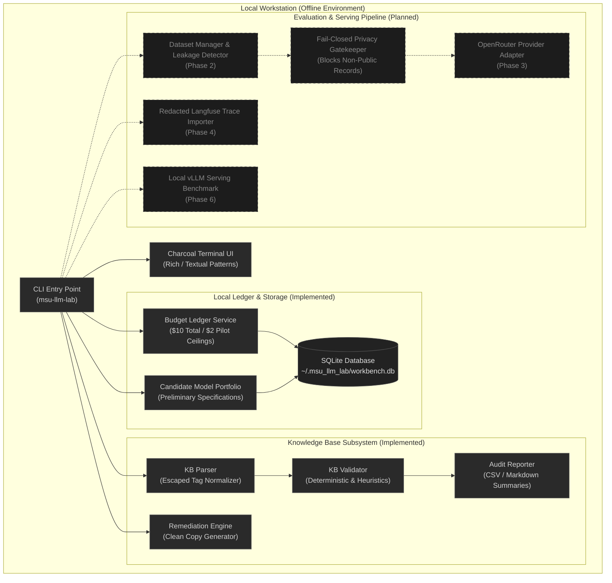

<div align="center">
  

  <h1>MSU LLM Inference Workbench</h1>

  <p><strong>Model evaluation · Inference systems · Observability</strong></p>

  <p>A local-first engineering workbench for auditing admissions knowledge bases, evaluating candidate language models, tracking experiment budgets, and investigating inference-system behavior.</p>

  <p>
    
    
    
    
    
  </p>
</div>

---

## Project Status

The workbench is in **active research and development**. The project foundation, knowledge-base audit engine, persistent budget ledger, candidate model catalogue, and terminal interface (TUI) are fully implemented and verified locally.

| Operational Dimension | Current State | Verification Detail |
|---|---|---|
| **Development Phase** | Phase 1 Complete / Phase 2 Ready | Knowledge-base audit, remediation engine, budget ledger, and TUI operational |
| **Execution Mode** | `LOCAL_ONLY` (Offline) | All CLI operations run against local disk and SQLite; zero outbound network calls |
| **Provider API Calls** | **Disabled** | No live API requests or external calls enabled; all baseline metrics at `$0.0000` |
| **Data Safety** | Read-Only & Immutability Enforced | Source markdown files protected with pre- and post-execution SHA-256 hash checks |
| **Test Suite** | **37 / 37 Passing** | Automated pytest coverage across parser, budget ledger, remediation, and TUI |

---

## Why This Project Exists

Management and Science University (MSU), Malaysia, deploys an AI counsellor to assist prospective and current students with academic programmes, entry requirements, tuition fees, and administrative procedures.

This workbench provides an offline, evidence-based systems environment to:

1. **Audit Knowledge-Base Quality**: Identify syntax flaws, unclosed tags, duplicate questions, and contradictory figures (such as conflicting fee amounts) in source documents before they can cause model hallucinations.
2. **Build Controlled Evaluation Datasets**: Standardize evaluation cases with strict confidentiality boundaries (`PUBLIC`, `SYNTHETIC`, `INTERNAL`, `CONFIDENTIAL`, `UNCLASSIFIED`) and cross-split leakage prevention (*Phase 2*).
3. **Benchmark Candidate Language Models**: Compare proprietary baselines against efficient open-weight models (such as `Qwen 3 8B` and `Qwen 3 14B`) for accuracy, groundedness, latency, and cost (*Phase 3*).
4. **Enforce Local Budget Policies**: Prevent runaway experiment costs using a local SQLite-backed ledger with strict pilot ($2.00) and cumulative ($10.00) ceilings, per-run caps, and circuit breakers.
5. **Investigate Inference Serving & Concurrency**: Profile self-hosted serving using vLLM, measuring token throughput, TTFT (time-to-first-token), KV-cache memory footprints, and multi-user concurrency limits (*Phase 6*).

---

## System Capabilities

| Capability | Module | Description | Status |
|---|---|---|---|
| **KB Syntax & Structure Parser** | `msu_llm_lab.audit.parser` | Parses escaped markdown tags (`\*\*Question:\*\*`, `\*\*Answer:\*\*`, `\#\#`), normalizes multiline records, and flags orphan lines. | **Implemented** |
| **Deterministic & Heuristic Validator** | `msu_llm_lab.audit.validator` | Detects missing answers, empty question fields, verbatim duplicate questions, and conflicting tuition amounts. | **Implemented** |
| **Cryptographic Hash Verification** | `msu_llm_lab.cli` | Computes pre- and post-audit SHA-256 checksums to verify source knowledge-base files remain 100% immutable. | **Implemented** |
| **Remediation & Patch Engine** | `msu_llm_lab.remediation` | Isolates confirmed content defects from contradictory figures requiring official verification; generates versioned clean copies. | **Implemented** |
| **Persistent Budget Ledger** | `msu_llm_lab.core.budget` | SQLite-backed ACID tracking for pilot ($2.00) and total ($10.00) policy ceilings, run estimates, and per-case circuit breakers. | **Implemented** |
| **Candidate Portfolio Catalogue** | `msu_llm_lab.models.catalog` | Stores evaluation candidate definitions, preliminary token pricing, deployment modes, and verification statuses. | **Implemented** |
| **Charcoal Terminal UI (TUI)** | `msu_llm_lab.tui` | Full-screen terminal dashboard with system telemetry, candidate inspector, audit views, and monochrome histogram charts. | **Implemented** |
| **Evaluation Schemas & Leakage Detector** | `msu_llm_lab.dataset` | Pydantic evaluation schemas with fail-closed confidentiality gating and n-gram train/dev/test leakage detection. | *Planned (Phase 2)* |
| **Fail-Closed OpenRouter Provider** | `msu_llm_lab.providers` | Evaluates approved non-sensitive cases against hosted APIs with secret scrubbing, rate-limit backoff, and dry-run mocks. | *Planned (Phase 3)* |
| **Offline RAG Trace Analyzer** | `msu_llm_lab.traces` | Ingests redacted Langfuse exports to diagnose routing, retrieval, generation, and source knowledge failure modes. | *Planned (Phase 4)* |
| **Inference Serving Benchmarks** | `msu_llm_lab.serving` | Benchmarks local vLLM deployments across concurrency levels, prompt lengths, and KV-cache configurations. | *Planned (Phase 6)* |

---

## Architecture Overview



---

## Installation & Quick Start

### Prerequisites
- Python 3.11 or newer
- [`uv`](https://github.com/astral-sh/uv) (recommended) or standard `pip`

### 1. Environment Setup

```bash
# Clone the repository
git clone https://github.com/Sudharsanselvaraj/Model-Systems-Workbench.git
cd Model-Systems-Workbench

# Create virtual environment and install dependencies with uv
uv sync

# Or using standard pip
python3 -m venv .venv
source .venv/bin/activate
pip install -e ".[dev]"
```

### 2. Launch the Interactive Terminal UI

The workbench includes a full-screen, charcoal-monochrome dashboard inspired by `btop` and `lazygit`:

```bash
# Launch interactive TUI
uv run msu-llm-lab ui

# Or using the root command directly
uv run msu-llm-lab
```

*Keybindings in TUI:*
- `Tab` / `Shift+Tab`: Cycle between tabs (`[1] Dashboard`, `[2] Models`, `[3] Audit`, `[4] Traces`)
- `↑` / `↓` / `k` / `j`: Navigate candidate list or logs
- `b`: Open spend ledger status
- `r`: Refresh telemetry and views
- `q`: Exit

### 3. Verify Budget Status

Inspect current local spend, configured policy ceilings, and per-run safety rules:

```bash
uv run msu-llm-lab budget status
```

*Output summary:*
```text
Spend & Policy Overview
─────────────────────────────────────────────────────────────────────────────
Initial Pilot Budget       $2.0000     $0.0000     $2.0000     ACTIVE
Total Experiment Ceiling  $10.0000     $0.0000    $10.0000     ACTIVE

Per-Execution Safety Rules
─────────────────────────────────────────────────────────────────────────────
Max Single Run Spend       $0.5000     Preflight check rejects run if exceeded
Max Single Case Spend      $0.0200     Per-case circuit breaker halts run
Execution Mode             Dry-Run     Requires explicit confirmation
```

### 4. Inspect Model Evaluation Portfolio

List current candidate models registered in the local SQLite portfolio:

```bash
uv run msu-llm-lab models list
```

### 5. Run a Safe Knowledge-Base Audit

Audit a source knowledge-base markdown document without modifying the file. Pre- and post-execution SHA-256 checksums guarantee zero data mutation:

```bash
# Safe dry-run audit (in-memory summary only)
uv run msu-llm-lab audit-kb "Copy of MSU Programmes KB - Local - Sudharsan.md" --dry-run

# Full audit producing structured CSV and Markdown reports
uv run msu-llm-lab audit-kb "Copy of MSU Programmes KB - Local - Sudharsan.md" --output-dir reports
```

### 6. Inspect Remediation Findings

Review confirmed defects vs contradictory facts requiring official MSU verification:

```bash
# Dry-run evaluation of remediation rules
uv run msu-llm-lab remediate-kb "Copy of MSU Programmes KB - Local - Sudharsan.md"

# Generate a clean, versioned copy (original file remains untouched)
uv run msu-llm-lab remediate-kb "Copy of MSU Programmes KB - Local - Sudharsan.md" \
  --apply \
  --output data/remediated/MSU_Programmes_KB_v1.1_clean.md
```

---

## Candidate Model Portfolio

The evaluation portfolio tracks candidate architectures for prospective migration from hosted APIs to self-hosted inference.

> [!NOTE]
> All entries in the catalog are currently designated `UNVERIFIED_CATALOG_ENTRY`. They represent planning baselines and preliminary pricing; they have **not yet been dispatched against live APIs** (scheduled for Phase 3 under strict confidentiality guardrails).

| Model Identifier | Display Name | Target Deployment | Est. $/1M (In / Out) | License | Role in Evaluation |
|---|---|---|---|---|---|
| `google/gemini-3.5-flash-lite` | Gemini 3.5 Flash Lite | Hosted Direct | $0.08 / $0.30 | Proprietary Commercial API | High-throughput multimodal baseline for student counselling triage |
| `anthropic/claude-haiku-5.5` | Claude Haiku 5.5 | Hosted Direct | $0.80 / $4.00 | Proprietary Commercial API | Fast hosted candidate for complex query reasoning |
| `openai/gpt-6-luna` | GPT-6 Luna | Hosted Direct | $0.15 / $0.60 | Proprietary Commercial API | Quality ceiling reference for evaluation scoring |
| `qwen/qwen3-8b` | Qwen 3 8B | Self-Hosted (vLLM) / Hosted | $0.20 / $0.20 | Open (License TBD) | Primary open-weight candidate for self-hosted serving |
| `qwen/qwen3-14b` | Qwen 3 14B | Self-Hosted (vLLM) / Hosted | $0.35 / $0.40 | Open (License TBD) | Secondary open-weight candidate for capacity and reasoning comparison |

---

## Data Integrity, Confidentiality & Safety Boundaries

The workbench operates under strict safety invariants designed for institutional research:

1. **Source File Immutability**: Original knowledge-base markdown files are strictly read-only. Audit commands compute a pre-execution SHA-256 hash and verify it against a post-execution hash. If any byte difference is detected, the process aborts with an exit code of `2`.
2. **Deterministic Remediation**: Remediation rules produce separate versioned clean files. The system never silently corrects or guesses contradictory values (such as whether an Applied Science PhD fee is RM62,500 or RM63,500); discrepancies are categorized as `OFFICIAL_VERIFICATION_PENDING` and escalated to human academic reviewers.
3. **Fail-Closed Confidentiality Gate**: Before any future external API call is dispatched, records must pass through a strict classification gatekeeper. Only items explicitly categorized as `PUBLIC` or `SYNTHETIC` are eligible for external routing. `UNCLASSIFIED`, `INTERNAL`, and `CONFIDENTIAL` records are blocked before network dispatch.
4. **Credential Isolation**: No API keys, tokens, or credentials are hardcoded or tracked in version control. `.gitignore` explicitly excludes `.env`, `data/`, `reports/`, and SQLite databases (`*.sqlite`, `*.db`).
5. **Budget Ceilings**: Local policy limits ($10.00 cumulative ceiling, $2.00 pilot ceiling, $0.50 per-run cap, $0.02 per-case circuit breaker) halt execution locally before external accounts can incur unexpected costs.

---

## Engineering Roadmap

```text
[✓] Phase 0: Workspace Discovery & Architectural Alignment
    ├── Repository inventory and formatting quirk analysis
    ├── Distinct accounting: raw markers vs parsed records vs defects
    └── Approved implementation plan & security boundaries

[✓] Phase 1: Knowledge-Base Audit & Local Systems Foundation
    ├── Resilient markdown parser with escaped tag support
    ├── Deterministic checks and heuristic anomaly validators
    ├── Cryptographic hash checks ensuring source immutability
    ├── Remediation engine with human escalation categories
    ├── Persistent SQLite budget ledger and policy ceilings
    ├── Candidate portfolio catalog management
    └── Charcoal-monochrome terminal UI (btop-inspired)

[ ] Phase 2: Evaluation Dataset, Schemas & Leakage Prevention (Next Milestone)
    ├── Formal Pydantic schemas (EvaluationCase, VerificationStatus)
    ├── Fail-closed confidentiality categorization
    ├── Dataset split manager (train / dev / test)
    ├── N-gram lexical cross-split leakage detector
    └── Verified synthetic seed dataset

[ ] Phase 3: Reproducible OpenRouter Model Evaluation
    ├── Provider abstraction with rate-limit retry backoff
    ├── Preflight secret scrubbing and zero-network dry-run mode
    ├── Automated prompt versioning and token count tracking
    └── Empirical comparison across accuracy, groundedness, and latency

[ ] Phase 4: Offline RAG Analysis & Langfuse Trace Ingestion
    ├── Redacted Langfuse export parser (JSON / CSV)
    ├── Automated failure classification (routing, retrieval, generation, KB)
    └── Diagnostic reports with hypothesis tagging

[ ] Phase 5: Fine-Tuning Feasibility & Dataset Preparation
    ├── Domain adaptation dataset extraction from verified KB records
    ├── Parameter-efficient fine-tuning (LoRA / QLoRA) configuration manifests
    └── Target GPU memory and compute requirement projections

[ ] Phase 6: Local Inference Serving Benchmarks (vLLM)
    ├── Docker / containerized vLLM serving configuration
    ├── Concurrency profiling (1, 5, 10, 25 concurrent requests)
    ├── TTFT and token generation throughput measurement
    └── KV-cache memory pressure and sizing analysis

[ ] Phase 7: Local Research Dashboard
    ├── Interactive visualization for multi-model benchmark results
    └── Latency vs quality trade-off frontiers
```

---

## Repository Layout

```text
Model-Systems-Workbench/
├── assets/
│   └── readme/
│       └── hero.png                     # Terminal dashboard hero image
├── docs/
│   ├── ARCHITECTURE.md                  # System architecture and security boundaries
│   ├── IMPLEMENTATION_PLAN.md           # Multi-phase engineering roadmap
│   └── PROJECT_MAP.md                   # Workspace inventory and file conventions
├── src/
│   └── msu_llm_lab/
│       ├── __init__.py                  # Package root and version
│       ├── cli.py                       # Typer CLI application entry point
│       ├── audit/                       # Phase 1: KB audit subsystem
│       │   ├── models.py                # Audit issue models and severities
│       │   ├── parser.py                # Escaped markdown tag parser
│       │   ├── reporter.py              # CSV and Markdown report generators
│       │   └── validator.py             # Deterministic and heuristic validators
│       ├── core/                        # Core system services
│       │   ├── budget.py                # Spend tracking and policy limit checks
│       │   └── db.py                    # SQLite database manager
│       ├── models/                      # Model catalog subsystem
│       │   └── catalog.py               # Candidate model definitions and seeding
│       ├── remediation/                 # KB remediation subsystem
│       │   ├── engine.py                # Remediation engine & clean writer
│       │   ├── models.py                # Finding classifications and statuses
│       │   └── rules.py                 # Confirmed defect remediation rules
│       └── tui/                         # Terminal user interface
│           ├── app.py                   # Persistent application loop
│           ├── charts.py                # Monochrome histogram renderers
│           ├── screens.py               # Panel renderers (Dashboard, Models, Audit)
│           └── theme.py                 # Charcoal monochrome design tokens
├── tests/
│   ├── conftest.py                      # Shared test fixtures and in-memory DB
│   ├── test_audit.py                    # Parser, validator, and report tests
│   ├── test_budget.py                   # Ledger transactions and limit tests
│   ├── test_remediation.py              # Remediation rules and immutability tests
│   └── test_tui.py                      # Terminal UI panel and chart tests
├── .gitignore                           # Excludes env, keys, data, reports, DBs
├── pyproject.toml                       # Build configuration and CLI scripts
├── uv.lock                              # Deterministic dependency lockfile
└── README.md                            # Project documentation (this file)
```

---

## Development & Verification

Run the automated test suite locally:

```bash
# Run all tests using uv
uv run pytest

# Run with verbose output and test names
uv run pytest -v

# Run a specific test module
uv run pytest tests/test_audit.py
uv run pytest tests/test_tui.py
```

All 37 unit tests run in less than 0.3 seconds against an in-memory SQLite database without network dependencies.

---

## Documentation Links

- [System Architecture](docs/ARCHITECTURE.md) — Architectural design, data flows, and security constraints.
- [Implementation Plan](docs/IMPLEMENTATION_PLAN.md) — Step-by-step phased roadmap, acceptance criteria, and milestones.
- [Project Map](docs/PROJECT_MAP.md) — Workspace inventory, data quirks, and counting methodology.

---

## License & University Context

This workbench is an internal research tool developed for evaluation, auditing, and optimization of the admissions language model systems at Management and Science University (MSU). 

Original source knowledge-base documents and university data remain the proprietary property of MSU. Open-source licensing for workbench tooling and evaluation harnesses is under review.
