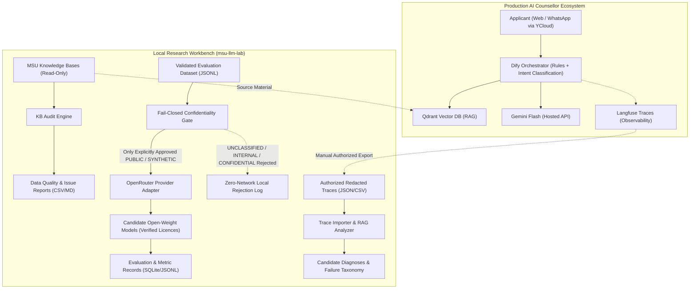
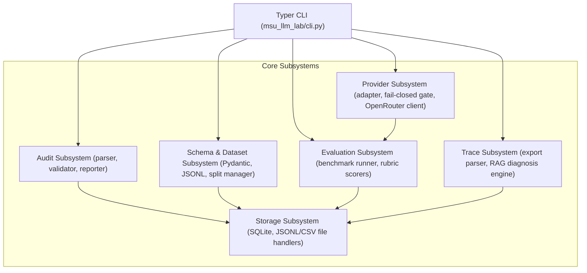
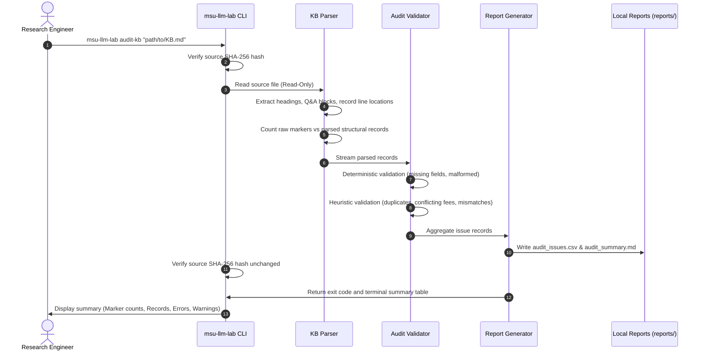
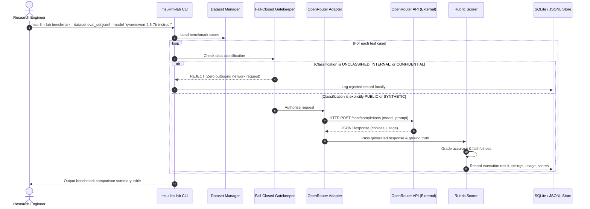

# System Architecture: MSU LLM Research Workbench (`msu-llm-lab`)

**Status**: Phase 0 — Architecture Specification (Approved with Corrections)  
**Date**: October 2026  

---

## 1. Architectural Overview & Context

The MSU LLM Research Workbench (`msu-llm-lab`) is an engineering research tool built to systematically investigate, evaluate, and improve the admissions AI counsellor for Management and Science University (MSU), Malaysia.

The overall environment spans two distinct contexts:
1. **The Production Conversational System**: Deployed by the organization, serving prospective students via Web chat and WhatsApp.
2. **The Local Research Workbench (`msu-llm-lab`)**: A local, CLI-driven environment for data audit, controlled evaluation, model comparison, trace diagnosis, and deployment analysis.

*Decoupled Trace Analysis*: The Trace Importer & RAG Analyzer runs independently as soon as an authorized, redacted export is available, without waiting for or depending on OpenRouter model benchmarking.

---

## 2. Core Architectural Principles of `msu-llm-lab`

1. **CLI-First as Source of Truth**: All audits, schema validations, benchmark executions, and trace ingestions are initiated and controlled via the Typer CLI.
2. **Strict Read-Only Access & Cryptographic Verification**: Original knowledge base files are strictly immutable. SHA-256 hashes are verified before and after all audit operations.
3. **Fail-Closed Confidentiality Gate**: The tool operates local-by-default. Outbound API calls (e.g., to OpenRouter) pass through an active gatekeeper that rejects all records unless explicitly classified as `PUBLIC` or `SYNTHETIC`. Any record marked `UNCLASSIFIED`, `INTERNAL`, or `CONFIDENTIAL` is blocked before any network call. Automated tests guarantee zero outbound network requests on rejected cases.
4. **Honest Accounting & No Hallucinated Metrics**: Missing trace data, uncalculated costs, or heuristic diagnostic findings are explicitly marked as `unavailable` or `candidate diagnosis`, never filled with synthetic defaults.
5. **Decoupled Workloads & Independent Phases**: Data auditing, evaluation benchmarking, offline trace analysis, model fine-tuning planning, and inference serving evaluation are modeled as independent, verifiable modules. Trace import does not block on model benchmarking.

---

## 3. Subsystem Architecture

The workbench is organized into modular Python components:

### 3.1 Knowledge-Base Audit Subsystem (`msu_llm_lab.audit`)
- **Parser (`parser.py`)**: Tokenizes raw markdown containing escaped syntax (`\*\*Question:\*\*`, `\*\*Answer:\*\*`, `\#\#`), handles multi-line blocks, detects question-answer pairings, and preserves source line numbers.
  - *Counting Distinction*: Explicitly separates raw regex marker counts from parsed structural records and confirmed defects.
- **Validator (`validator.py`)**: Runs two tiers of checks:
  1. *Deterministic Errors*: Missing answers, empty questions, broken markdown syntax, missing required fields.
  2. *Heuristic Warnings*: Duplicate questions (exact and normalized), fee/number conflicts across entries, suspected programme name mismatches, time-sensitive dates needing verification.
- **Reporter (`reporter.py`)**: Produces structured CSV issue logs (for human verification workflows) and executive Markdown summaries in `reports/`.

### 3.2 Evaluation Dataset & Schemas (`msu_llm_lab.schemas` & `msu_llm_lab.dataset`)
- **Pydantic Data Contracts**:
  - `EvaluationCase`: Unique ID, query text, category (e.g., fee, entry requirement, campus), difficulty level, data classification (`PUBLIC`, `SYNTHETIC`, `INTERNAL`, `CONFIDENTIAL`, `UNCLASSIFIED`).
  - `VerificationRecord`: Status (`UNVERIFIED`, `VERIFIED`, `DISPUTED`), authoritative source reference, verification timestamp, verifier identity.
  - `ModelExecutionRecord`: Model ID, prompt template version, raw model output, provider latency, token usage, cost estimate.
  - `EvaluationScore`: Rubric-based scoring (Factual Correctness, Groundedness/Faithfulness, Format Compliance, Abstention Accuracy).
- **Split Management & Leakage Prevention**:
  - Maintains strict partition between Training (`train`), Development (`dev`), and Held-Out Evaluation (`eval`) sets.
  - Implements lexical and n-gram overlap checks to flag potential cross-split leakage.

### 3.3 Provider Adapter & Fail-Closed Confidentiality Gate (`msu_llm_lab.providers`)
- **Abstract Provider Interface (`base.py`)**: Defines standard methods (`generate()`, `health_check()`) and enforces common error handling, rate limiting, and timeout behaviors.
- **Fail-Closed Confidentiality Gatekeeper**:
  - Intercepts requests prior to transmission.
  - **Rule**: If a test case is classified as `UNCLASSIFIED`, `INTERNAL`, or `CONFIDENTIAL`, the request is rejected immediately with an informative error.
  - Only test cases explicitly classified as `PUBLIC` or `SYNTHETIC` are eligible for external API dispatch.
  - Test suites include unit tests verifying zero outbound network calls are made for non-approved cases.
- **OpenRouter Adapter (`openrouter.py`)**:
  - Requires explicit `model_id` (no implicit default fallback).
  - Model Candidate Licensing: Open-weight candidate models are evaluated under their specific license terms. For example, Qwen models are generally released under Apache 2.0, whereas Llama models are governed by the Meta Llama Community License. The current candidate list lives in `models/catalog.py`; IDs and prices there are unverified planning baselines. Licenses and commercial use terms are verified individually.
  - Reads `OPENROUTER_API_KEY` from the environment without logging or printing the key.
  - Implements bounded exponential backoff for HTTP 429 (rate limits) and 5xx responses.
  - Computes cost estimates based on explicit model pricing metadata; marks costs as `ESTIMATED` or `UNAVAILABLE` when exact billing metrics are absent.

### 3.4 Trace Importer & Diagnostic Engine (`msu_llm_lab.traces`)
- **Decoupled Workflow**: Operates independently from provider benchmarking. Can be executed whenever an authorized redacted trace export is supplied.
- **Redacted Trace Parser (`importer.py`)**: Parses offline JSON/CSV exports from Langfuse. Preserves trace IDs, span IDs, parent relationships, input/output text, and timestamps.
- **Diagnostic Engine (`analyzer.py`)**: Categorizes observed failures into a standardized failure taxonomy:
  - *Intent/Routing Failure*: Free-text query directed to incorrect flow.
  - *Retrieval Failure*: Qdrant returned wrong programme context or omitted necessary facts.
  - *Generation Failure*: Context contained correct fact, but model fabricated or misstated answer.
  - *Source Knowledge Failure*: Retrieved document itself contained inaccurate or conflicting data.
  - *Operational Failure*: Timeout, API error, or token limit truncation.
- All diagnoses are explicitly flagged as *candidate hypotheses* requiring engineer confirmation.

---

## 4. End-to-End Data Flows

### 4.1 Knowledge-Base Audit Flow

### 4.2 Benchmark Evaluation & Fail-Closed Confidentiality Flow

---

## 5. Security & Confidentiality Boundaries

| Boundary | Threat / Risk | Mitigation in `msu-llm-lab` |
| :--- | :--- | :--- |
| **Outbound Data Exfiltration** | Accidental transmission of applicant PII, unclassified data, or proprietary university records to external APIs. | **Fail-Closed Confidentiality Gate**: Rejects all records unless explicitly categorized as `PUBLIC` or `SYNTHETIC`. Blocks `UNCLASSIFIED`, `INTERNAL`, and `CONFIDENTIAL` before network call. Tested with zero-request assertions. |
| **Credential Leakage** | Leaking `OPENROUTER_API_KEY` or Langfuse credentials in code, logs, git commits, or reports. | Secrets loaded exclusively via `os.environ`. Scrubbers on logger and exception handlers. Strict `.gitignore` excludes `.env`, logs, traces, and credentials. |
| **Source Data Corruption** | Modifying original knowledge base files during cleaning, normalization, or auditing. | Strict read-only filesystem access. Pre- and post-audit SHA-256 hash checks verify zero modification. All outputs write exclusively to separate directories (`reports/`, `data/`). |
| **Unverified Ground Truth** | Synthetic or unverified LLM answers contaminating evaluation datasets as authoritative truth. | Pydantic schema strictly enforces `VerificationStatus.VERIFIED` with mandatory `verified_by` and `source_reference` fields before any answer is treated as ground truth. |
| **Model License Non-Compliance** | Misunderstanding licensing constraints of candidate models for commercial or internal deployment. | Open-weight models are categorized by exact license (e.g. Apache 2.0 for Qwen 2.5 vs Meta Community License for Llama 3.1). Terms are documented before selection. |
| **Infrastructure Cost Runaways** | Uncontrolled loops or high concurrency exhausting API credits or GPU budgets. | Bounded execution batches, configurable rate-limiters, per-run token limits, and strict approval requirements before starting external or GPU jobs. |
