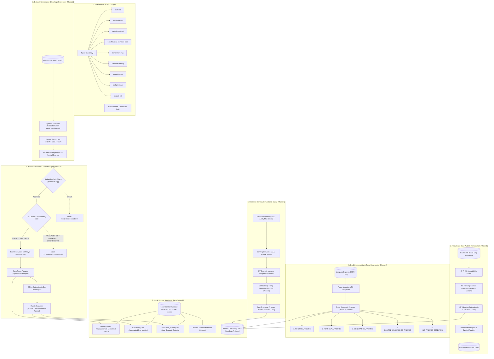
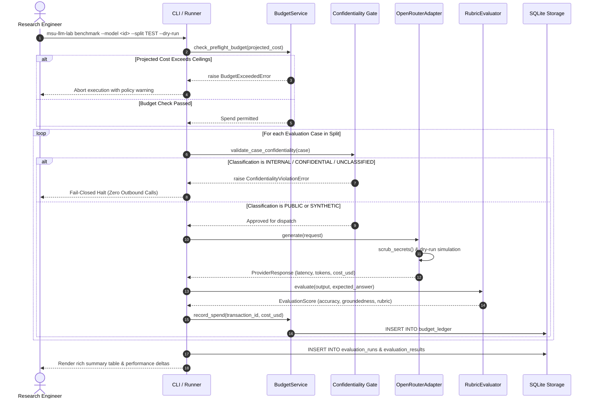
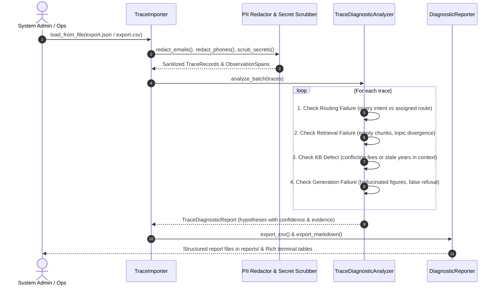

# MSU LLM Workbench — Complete System Architecture (Phases 0–6)

---

## Component Interaction Lifecycles

### A. Model Evaluation & Spend Lifecycle (Phase 3)

---

### B. Production Trace Ingestion & Diagnostic Lifecycle (Phase 4)

---

## Subsystem Matrix (Phases 0 to 6)

| Subsystem | Primary Python Modules | CLI Command | Core Safety / Invariant |
|---|---|---|---|
| **Audit & Remediation** | `msu_llm_lab.audit.*` `msu_llm_lab.remediation.*` | `msu-llm-lab audit-kb` `msu-llm-lab remediate-kb` | Source KB is read-only; SHA-256 hashed before and after. Never auto-resolves contradictions. |
| **Dataset Governance** | `msu_llm_lab.schemas.*` `msu_llm_lab.dataset.*` | `msu-llm-lab validate-dataset` | Verified cases require explicit source citations. N-gram detector prevents cross-split leakage. |
| **Evaluation & Providers** | `msu_llm_lab.providers.*` `msu_llm_lab.evaluation.*` | `msu-llm-lab benchmark` `msu-llm-lab compare-runs` | Fail-closed gate blocks non-public cases. Dry-run by default. Preflight budget limits enforced. |
| **Decoupled RAG Benchmark** | `msu_llm_lab.rag.*` | `msu-llm-lab benchmark-rag` | Evaluates retrieval (Recall@k, Precision@k, MRR) against 3,030 clean audited KB records; isolates abstention denominator (v2.1 baseline). |
| **Trace Diagnostics** | `msu_llm_lab.traces.*` | `msu-llm-lab import-traces` | PII and API keys redacted offline. Classifications labeled as candidate hypotheses, not ground truth. |
| **Inference Serving & Sizing** | `msu_llm_lab.serving.*` | `msu-llm-lab simulate-serving` | Hardware sizing, KV-cache footprint, concurrency ramp (1–150 workers), and cloud vs self-hosted cost crossover. |
| **Spend Governance** | `msu_llm_lab.core.budget` `msu_llm_lab.storage.db` | `msu-llm-lab budget status` | Exact `Decimal` arithmetic and integer micro-dollars. Local governance ceilings ($0.50/$2.00/$10.00). |
| **Interactive Terminal** | `msu_llm_lab.tui.*` | `msu-llm-lab ui` | Hardware telemetry, tab navigation, model catalog, and budget ledger inspection. |
