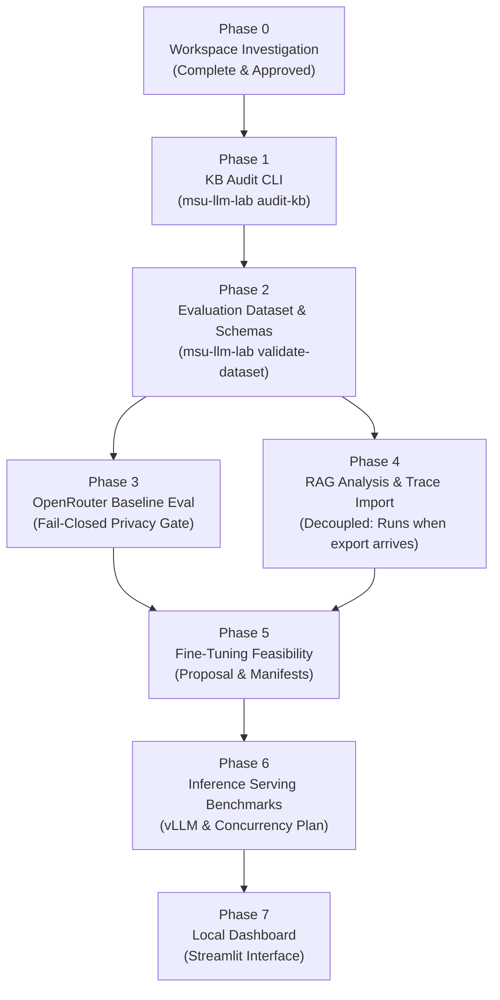

# Implementation Plan: MSU LLM Research Workbench (`msu-llm-lab`)

**Status**: Phases 0–6 Complete; Benchmark v2.1 Baseline Hardened; Phase 7 Next  
**Date**: October 2026  

---

## 1. Overview and Engineering Methodology

The implementation follows a strict phased, evidence-based development methodology. Each phase produces a testable, standalone capability with its own acceptance criteria, tests, and documentation. No phase proceeds without explicit review and approval from the project lead.

### Core Working Rules:
- **Zero Hallucinated Metrics**: Missing values are reported as unavailable, never fabricated.
- **Source Immutability & Hash Verification**: The original knowledge-base files are strictly read-only. Cryptographic SHA-256 hashes are verified before and after each audit.
- **Fail-Closed Confidentiality**: Outbound API traffic is barred unless a record is explicitly categorized as `PUBLIC` or `SYNTHETIC`. `UNCLASSIFIED`, `INTERNAL`, and `CONFIDENTIAL` records are blocked before network dispatch.
- **Decoupled Research Streams**: Trace import and diagnosis do not block on external model benchmarking; each proceeds as soon as prerequisites are ready.
- **Accurate Model Licensing**: Candidate models are evaluated under their specific open-weight licenses (distinguishing permissive licenses like Apache 2.0 from custom licenses like the Meta Llama Community License).
- **No Unapproved Infrastructure**: No paid cloud instances, GPUs, or fine-tuning runs will be initiated without explicit approval.
- **Definition of Done**: A phase is complete only when code, automated tests, safe sample runs, documentation, and error cases pass.

---

## 2. Phase-by-Phase Roadmap

---

### Phase 0: Workspace Investigation & Architecture Alignment *(Complete & Approved)*
* **Objective**: Discover workspace state, document file formats, confirm dependencies, reconcile counting methodology, and formulate architecture and implementation plan.
* **Deliverables**:
  - `docs/PROJECT_MAP.md` (Confirmed repository state, file inventory, anomalies, layout).
  - `docs/ARCHITECTURE.md` (System architecture, production vs workbench context, data flows, security boundaries).
  - `docs/IMPLEMENTATION_PLAN.md` (Phased roadmap, acceptance criteria, dependencies, open questions).
  - Phase 0 Investigation Report presenting verified facts, unknown items, and next steps.
* **Acceptance Criteria**:
  - No application code written, no external APIs contacted, no packages installed.
  - Complete discovery of the two MSU knowledge-base files and formatting quirks.
  - Clear distinction between raw marker counts, parsed records, and confirmed defects.

---

### Phase 1: Knowledge-Base Audit CLI *(Complete)*
* **Command**: `msu-llm-lab audit-kb [OPTIONS] [FILE_PATH]`
* **Status**: Complete. 3,051 parsed records (241 General KB, 2,810 Programmes KB), deterministic and heuristic validators, versioned clean copies without touching sources.

---

### Phase 2: Evaluation Dataset and Schemas *(Complete)*
* **Command**: `msu-llm-lab validate-dataset [OPTIONS] DATASET_FILE`
* **Status**: Complete. Pydantic schemas, split management (TRAIN/DEV/TEST), n-gram cross-split leakage detector.

---

### Phase 3: Reproducible OpenRouter Evaluation *(Complete)*
* **Command**: `msu-llm-lab benchmark [OPTIONS]` and `msu-llm-lab compare-runs [RUN_A] [RUN_B]`
* **Status**: Complete. OpenRouter adapter, fail-closed confidentiality gatekeeper, budget ledger, rubric evaluation, and dry-run simulation.

---

### Phase 4: RAG Analysis and Langfuse Export Import *(Complete)*
* **Command**: `msu-llm-lab import-traces [OPTIONS] EXPORT_FILE`
* **Status**: Complete. Redacted JSON/CSV importer, PII scrubber, diagnostic classification across routing, retrieval, generation, and KB failure modes.

---

### Phase 5: Decoupled RAG Benchmarking & Ground-Truth Provenance *(Complete — Benchmark v2.1 Baseline)*
* **Command**: `msu-llm-lab benchmark-rag [OPTIONS]`
* **Status**: Complete. Replaced context-leakage retriever with uncontaminated BM25 index built directly from 3,030 clean audited KB records (21 defective records excluded under manifest policy). Ground-truth provenance partitioned into 3 verified source cases and 5 unresolved abstention cases. Metrics report Recall@k, Precision@k, MRR, and isolated Abstention Accuracy across top-2, 3, 5, 10.

---

### Phase 6: Inference Serving & Hardware Sizing Simulation *(Complete)*
* **Command**: `msu-llm-lab simulate-serving [OPTIONS]`
* **Status**: Complete. Automated vLLM serving simulation, memory footprint calculations (weights, KV-cache, activations), progressive concurrency ramps (1–150 workers), and cloud vs. on-premise cost crossover analysis across H100, A100, and Mac Studio unified memory profiles.

---

### Phase 7: Local Engineering Dashboard *(Current Target)*
* **Command**: `msu-llm-lab ui` / `msu-llm-lab dashboard`
* **Status**: Terminal UI operational via `msu-llm-lab ui` (Textual dashboard with health, model catalog, spend ledger); Streamlit local interface is next.

---

### Phase 7: Local Engineering Dashboard
* **Command**: `msu-llm-lab dashboard`
* **Objective**: Build a clean, local-only Streamlit interface allowing researchers to inspect KB audit logs, browse evaluation datasets, compare benchmark results, and review trace diagnoses.
* **Deliverables**:
  - Streamlit application (`src/msu_llm_lab/dashboard/app.py`).
  - Screens:
    1. Overview (dataset status, recent audit and benchmark runs).
    2. KB Audit Explorer (filter and review flagged records by category/severity).
    3. Evaluation Dataset Browser (inspect verification status, categories, splits).
    4. Model Comparison (latency, token usage, accuracy side-by-side).
    5. Trace Explorer (browse imported traces and candidate diagnoses).
    6. Report Exporter (download CSV/MD summaries).
  - Local-only execution (binds strictly to `localhost` / `127.0.0.1`).
* **Acceptance Criteria**:
  - Uses the exact same backend service modules as the CLI.
  - Displays unavailable metrics honestly without placeholder graphs or decorative fake data.
  - Clean, restrained engineering styling.
* **Dependencies**: Phase 6 approval.

---

## 3. Unresolved Decisions & Open Questions

| No. | Item | Context / Options | Recommended Default | Status |
| :---: | :--- | :--- | :--- | :--- |
| **1** | **Package & Virtualenv Management** | The system has both `uv` (`/opt/homebrew/bin/uv`) and standard `python3.11 -m venv`. `uv` offers faster, reproducible builds. | Use `uv` with standard `pyproject.toml`. | Resolved for Phase 1 (`uv` + `pyproject.toml`) |
| **2** | **Source of Ground Truth for Discrepancies** | The KBs contain conflicting facts (e.g. PhD Applied Science fees: RM62,500 vs RM63,500). Who or what is the official authority to verify corrections? | Flag in audit CSV as `Requires Human Verification`; do not guess or auto-resolve. | Confirmed policy |
| **3** | **Langfuse Export Format & Availability** | Access to production Langfuse is pending. We need to confirm whether exports will be provided as Langfuse V2/V3 JSON or CSV. | Implement parser accepting both standard Langfuse JSON export format and flat CSV export. | Pending sample export |
| **4** | **Data Classification Protocol for OpenRouter** | OpenRouter calls require data to be explicitly approved. What constitutes approved data: strictly synthetic prompts, or approved public website Q&As? | Fail-closed gate: allow only explicitly approved `PUBLIC` or `SYNTHETIC` records. Reject `UNCLASSIFIED`, `INTERNAL`, and `CONFIDENTIAL`. | Policy confirmed; awaiting test set sign-off |
| **5** | **Candidate Open-Weight Model Selection** | OpenRouter provides many models. Must verify licenses: Qwen 2.5 7B (Apache 2.0) vs Llama 3.1 8B (Meta Llama Community License). | Shortlist 2–3 open-weight models with documented license terms. | Awaiting team alignment |
| **6** | **RunPod Budget & Infrastructure Approvals** | GPU rental requires budget allocation and team sign-off. | Do not rent or configure RunPod until Phase 5/6 proposals are formally approved. | Confirmed rule |
