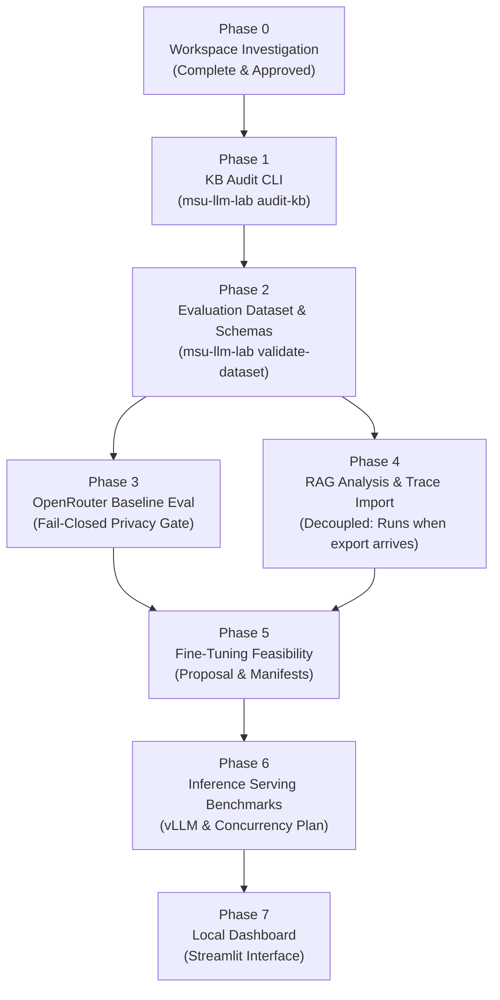

# Implementation Plan: MSU LLM Research Workbench (`msu-llm-lab`)

**Status**: Phase 0 — Roadmap & Engineering Plan (Approved with Corrections)  
**Date**: October 2026  

---

## 1. Overview and Engineering Methodology

The implementation follows a strict phased, evidence-based development methodology. Each phase produces a testable, standalone capability with its own acceptance criteria, tests, and documentation. No phase proceeds without explicit review and approval from the project lead.

### Core Working Rules:
- **Zero Hallucinated Metrics**: Missing values are reported as unavailable, never fabricated.
- **Source Immutability & Hash Verification**: The original knowledge-base files are strictly read-only. Cryptographic SHA-256 hashes are verified before and after each audit.
- **Fail-Closed Confidentiality**: Outbound API traffic is barred unless a record is explicitly categorized as `PUBLIC` or `SYNTHETIC`. `UNCLASSIFIED`, `INTERNAL`, and `CONFIDENTIAL` records are blocked before network dispatch.
- **Decoupled Research Streams**: Trace import and diagnosis do not block on external model benchmarking; each proceeds as soon as prerequisites are ready.
- **Accurate Model Licensing**: Candidate models are evaluated under their specific open-weight licenses (distinguishing permissive licenses like Apache 2.0 from custom licenses like the Meta Llama Community License).
- **No Unapproved Infrastructure**: No paid cloud instances, GPUs, or fine-tuning runs will be initiated without explicit approval.
- **Definition of Done**: A phase is complete only when code, automated tests, safe sample runs, documentation, and error cases pass.

---

## 2. Phase-by-Phase Roadmap

---

### Phase 0: Workspace Investigation & Architecture Alignment *(Complete & Approved)*
* **Objective**: Discover workspace state, document file formats, confirm dependencies, reconcile counting methodology, and formulate architecture and implementation plan.
* **Deliverables**:
  - `docs/PROJECT_MAP.md` (Confirmed repository state, file inventory, anomalies, layout).
  - `docs/ARCHITECTURE.md` (System architecture, production vs workbench context, data flows, security boundaries).
  - `docs/IMPLEMENTATION_PLAN.md` (Phased roadmap, acceptance criteria, dependencies, open questions).
  - Phase 0 Investigation Report presenting verified facts, unknown items, and next steps.
* **Acceptance Criteria**:
  - No application code written, no external APIs contacted, no packages installed.
  - Complete discovery of the two MSU knowledge-base files and formatting quirks.
  - Clear distinction between raw marker counts, parsed records, and confirmed defects.

---

### Phase 1: Knowledge-Base Audit CLI *(Current Target)*
* **Command**: `msu-llm-lab audit-kb [OPTIONS] [FILE_PATH]`
* **Objective**: Parse the supplied markdown files, reconcile raw regex marker counts vs parsed structural records, validate question-and-answer structure, identify formatting anomalies, detect duplicate questions, highlight conflicting figures, and generate audit reports without modifying source files.
* **Deliverables**:
  - Parsing module (`msu_llm_lab.audit.parser`) supporting escaped markdown tags (`\*\*Question:\*\*`, `\*\*Answer:\*\*`, `\#\#`) and inline/multiline entries.
  - Validation engine (`msu_llm_lab.audit.validator`) with deterministic rules and heuristic detectors.
  - Reporting module (`msu_llm_lab.audit.reporter`) outputting CSV issue logs and Markdown summaries into `reports/`.
  - Typer CLI command: `msu-llm-lab audit-kb` with `--dry-run`, `--format [csv|json|md]`, and `--output-dir` options.
  - Automated test suite (`tests/test_audit.py`) covering:
    - Valid single-turn and multi-turn entries.
    - Missing answer fields and empty question fields.
    - Duplicate questions (exact and normalized text).
    - Conflicting numeric amounts (e.g., fee discrepancies).
    - Malformed markdown and stray tokens (e.g. `cou`).
    - Source immutability verification.
* **Acceptance Criteria**:
  - Original source files remain 100% untouched (verified by SHA-256 hash checks before and after).
  - Parser explicitly distinguishes raw marker counts, parsed records, and validated defects (no hardcoded counts as ground truth).
  - Both deterministic errors and heuristic warnings are distinctly categorized.
  - Both supplied knowledge-base files audit successfully with complete issue logs generated in `reports/`.
  - Never automatically alters or decides which conflicting fee or requirement is correct.
  - All automated unit and integration tests pass.
* **Dependencies**: Phase 0 approval, Git repository initialization, `.gitignore` setup, Python environment setup.

---

### Phase 2: Evaluation Dataset and Schemas
* **Command**: `msu-llm-lab validate-dataset [OPTIONS] DATASET_FILE`
* **Objective**: Define formal Pydantic schemas for evaluation cases, ground truth, and scoring; implement dataset management with strict train/dev/test partitioning and cross-split leakage prevention.
* **Deliverables**:
  - Pydantic schema models:
    - `EvaluationCase`: ID, query, category, difficulty, data classification (`PUBLIC`, `SYNTHETIC`, `INTERNAL`, `CONFIDENTIAL`, `UNCLASSIFIED`).
    - `VerificationRecord`: Status (`UNVERIFIED`, `VERIFIED`, `DISPUTED`), reference source, verifier.
    - `ModelExecutionRecord`: Model ID, prompt version, output text, latency, token usage, cost.
    - `EvaluationScore`: Rubric-based scores for accuracy, groundedness, and format.
  - Dataset manager (`msu_llm_lab.dataset`) for reading and writing JSONL files.
  - Leakage detector (`msu_llm_lab.dataset.leakage`) using lexical and n-gram overlap heuristics to prevent cross-split contamination.
  - CLI command `msu-llm-lab validate-dataset` to validate schema conformance and flag leakage.
  - Safe initial seed dataset containing verified synthetic/sample cases (clearly labeled as synthetic).
  - Automated tests (`tests/test_schemas.py`) covering valid records, invalid types, unverified ground truth rejection, and leakage detection.
* **Acceptance Criteria**:
  - Schema rejects any record attempting to claim verified status without an explicit source citation.
  - Unclassified data defaults to blocked classification.
  - Cross-split contamination between train/dev/test is detected and reported.
  - All tests pass.
* **Dependencies**: Phase 1 approval.

---

### Phase 3: Reproducible OpenRouter Evaluation
* **Command**: `msu-llm-lab benchmark [OPTIONS]` and `msu-llm-lab compare-runs [RUN_A] [RUN_B]`
* **Objective**: Build a robust provider adapter for OpenRouter with a fail-closed confidentiality gate to benchmark candidate open-weight models on approved, non-sensitive evaluation datasets.
* **Deliverables**:
  - Provider interface (`msu_llm_lab.providers.base.BaseProvider`).
  - OpenRouter adapter (`msu_llm_lab.providers.openrouter.OpenRouterAdapter`):
    - Reads `OPENROUTER_API_KEY` from environment safely.
    - Requires explicit `model_id`.
    - **Fail-Closed Confidentiality Gatekeeper**: Rejects `UNCLASSIFIED`, `INTERNAL`, and `CONFIDENTIAL` records before making network requests. Only explicitly approved `PUBLIC` or `SYNTHETIC` records are permitted.
    - Configurable timeouts, retry backoff for rate limits (429) and server errors (5xx).
    - Dry-run mode performing zero network requests.
    - Raw request/response capture with sanitized secret scrubbers.
  - Benchmark coordinator (`msu_llm_lab.evaluation.runner`) and metric calculators.
  - Candidate model license documentation: Distinctly classifies candidate models (e.g. Qwen 2.5 7B under Apache 2.0 vs Llama 3.1 8B under Meta Llama Community License).
  - SQLite storage for run history and execution metadata.
  - Automated test suite (`tests/test_providers.py`) using mocked HTTP responses, including tests proving zero outbound network requests for rejected records.
* **Acceptance Criteria**:
  - Gatekeeper strictly halts and logs rejection for `UNCLASSIFIED`, `INTERNAL`, or `CONFIDENTIAL` cases.
  - Tests verify zero network requests on rejected inputs.
  - No API key or secret appears in logs, outputs, or error messages.
  - Dry-run mode functions without network access.
  - Missing provider metrics are explicitly marked `unavailable`.
  - Mocked tests achieve 100% pass rate with zero API spend.
* **Dependencies**: Phase 2 approval.

---

### Phase 4: RAG Analysis and Langfuse Export Import *(Decoupled)*
* **Command**: `msu-llm-lab import-traces [OPTIONS] EXPORT_FILE`
* **Objective**: Ingest authorized, redacted Langfuse export files (JSON/CSV) to diagnose production failure modes across routing, retrieval, generation, and source knowledge. Can proceed as soon as an export is available without waiting for Phase 3.
* **Deliverables**:
  - Redacted trace importer (`msu_llm_lab.traces.importer`) supporting Langfuse JSON and CSV export formats.
  - Trace validation ensuring trace IDs, observation IDs, parent-child spans, latencies, and token counts are preserved.
  - Diagnostic engine (`msu_llm_lab.traces.analyzer`) categorizing candidate issues:
    - Routing failures (misclassified intent).
    - Retrieval failures (irrelevant context, wrong programme).
    - Generation failures (unsupported claims, hallucination).
    - Source knowledge failures (KB inconsistency).
  - Diagnostic report generator (CSV and Markdown) clearly labeling findings as candidate hypotheses.
  - CLI command `msu-llm-lab import-traces`.
  - Automated test suite (`tests/test_traces.py`) using synthetic/redacted trace fixtures.
* **Acceptance Criteria**:
  - Importer cleanly parses valid exports and rejects malformed/corrupted files with clear errors.
  - Diagnostic classifications are distinctly labeled as hypotheses, not ground-truth verdicts.
  - Zero live dashboard scraping; offline file-based only.
* **Dependencies**: Phase 2 approval, receipt of authorized redacted trace sample (independent of Phase 3).

---

### Phase 5: Fine-Tuning Preparation & Feasibility Study
* **Objective**: Evaluate whether fine-tuning is justified by remaining failure modes (drawing evidence from both Phase 3 benchmarks and Phase 4 trace analyses), select appropriate open-weight base models, specify training methodology (LoRA/QLoRA), and create training manifests without launching jobs.
* **Deliverables**:
  - Comprehensive Fine-Tuning Feasibility Report addressing:
    1. Nature of recurring model failures (after prompt and RAG tuning).
    2. Base model selection (open-weight, documented license terms, e.g., Qwen 2.5 7B under Apache 2.0 or Llama 3.1 8B under Meta Community License).
    3. Dataset sufficiency and representation analysis.
    4. SFT / LoRA / QLoRA hyperparameter configuration.
    5. GPU memory, storage, and cost estimate (RunPod / usage-based compute).
    6. Held-out evaluation and regression testing strategy.
  - Training dataset preparation script and manifest generator.
  - Safeguard confirmation: Requires explicit, multi-step user confirmation before any training script or GPU allocation can be initiated.
* **Acceptance Criteria**:
  - Complete, evidence-based report answering all technical criteria.
  - Zero unauthorized GPU instances launched or costs incurred.
* **Dependencies**: Phase 3 and/or Phase 4 evidence, team review.

---

### Phase 6: Inference Serving & Concurrency Benchmark Proposal
* **Objective**: Formulate a rigorous, self-hosted inference evaluation methodology using vLLM to measure latency, throughput, concurrency (targeting 100+ concurrent requests), and GPU resource utilization.
* **Deliverables**:
  - Inference evaluation specification detailing:
    - Target serving engine: vLLM with OpenAI-compatible API.
    - Concurrency test ramp: 1, 5, 10, 25, 50, 100, 150 concurrent workers.
    - Metrics: p50, p95, p99 latency, TTFT, TPOT, requests/sec, tokens/sec.
    - Resource metrics: GPU memory, KV-cache utilization, prefix-cache hit rates, preemption rate.
    - Cost modeling: Idle vs active GPU instance pricing, serverless vs dedicated pods.
  - Synthetic load generation harness (mockable and runnable locally or against approved endpoints).
* **Acceptance Criteria**:
  - Realistic testing methodology that tests progressive concurrency rather than assuming 100 concurrent requests work.
  - Clear cost vs latency tradeoff model.
* **Dependencies**: Phase 5 approval.

---

### Phase 7: Local Engineering Dashboard
* **Command**: `msu-llm-lab dashboard`
* **Objective**: Build a clean, local-only Streamlit interface allowing researchers to inspect KB audit logs, browse evaluation datasets, compare benchmark results, and review trace diagnoses.
* **Deliverables**:
  - Streamlit application (`src/msu_llm_lab/dashboard/app.py`).
  - Screens:
    1. Overview (dataset status, recent audit and benchmark runs).
    2. KB Audit Explorer (filter and review flagged records by category/severity).
    3. Evaluation Dataset Browser (inspect verification status, categories, splits).
    4. Model Comparison (latency, token usage, accuracy side-by-side).
    5. Trace Explorer (browse imported traces and candidate diagnoses).
    6. Report Exporter (download CSV/MD summaries).
  - Local-only execution (binds strictly to `localhost` / `127.0.0.1`).
* **Acceptance Criteria**:
  - Uses the exact same backend service modules as the CLI.
  - Displays unavailable metrics honestly without placeholder graphs or decorative fake data.
  - Clean, restrained engineering styling.
* **Dependencies**: Phase 6 approval.

---

## 3. Unresolved Decisions & Open Questions

| No. | Item | Context / Options | Recommended Default | Status |
| :---: | :--- | :--- | :--- | :--- |
| **1** | **Package & Virtualenv Management** | The system has both `uv` (`/opt/homebrew/bin/uv`) and standard `python3.11 -m venv`. `uv` offers faster, reproducible builds. | Use `uv` with standard `pyproject.toml`. | Resolved for Phase 1 (`uv` + `pyproject.toml`) |
| **2** | **Source of Ground Truth for Discrepancies** | The KBs contain conflicting facts (e.g. PhD Applied Science fees: RM62,500 vs RM63,500). Who or what is the official authority to verify corrections? | Flag in audit CSV as `Requires Human Verification`; do not guess or auto-resolve. | Confirmed policy |
| **3** | **Langfuse Export Format & Availability** | Access to production Langfuse is pending. We need to confirm whether exports will be provided as Langfuse V2/V3 JSON or CSV. | Implement parser accepting both standard Langfuse JSON export format and flat CSV export. | Pending sample export |
| **4** | **Data Classification Protocol for OpenRouter** | OpenRouter calls require data to be explicitly approved. What constitutes approved data: strictly synthetic prompts, or approved public website Q&As? | Fail-closed gate: allow only explicitly approved `PUBLIC` or `SYNTHETIC` records. Reject `UNCLASSIFIED`, `INTERNAL`, and `CONFIDENTIAL`. | Policy confirmed; awaiting test set sign-off |
| **5** | **Candidate Open-Weight Model Selection** | OpenRouter provides many models. Must verify licenses: Qwen 2.5 7B (Apache 2.0) vs Llama 3.1 8B (Meta Llama Community License). | Shortlist 2–3 open-weight models with documented license terms. | Awaiting team alignment |
| **6** | **RunPod Budget & Infrastructure Approvals** | GPU rental requires budget allocation and team sign-off. | Do not rent or configure RunPod until Phase 5/6 proposals are formally approved. | Confirmed rule |
